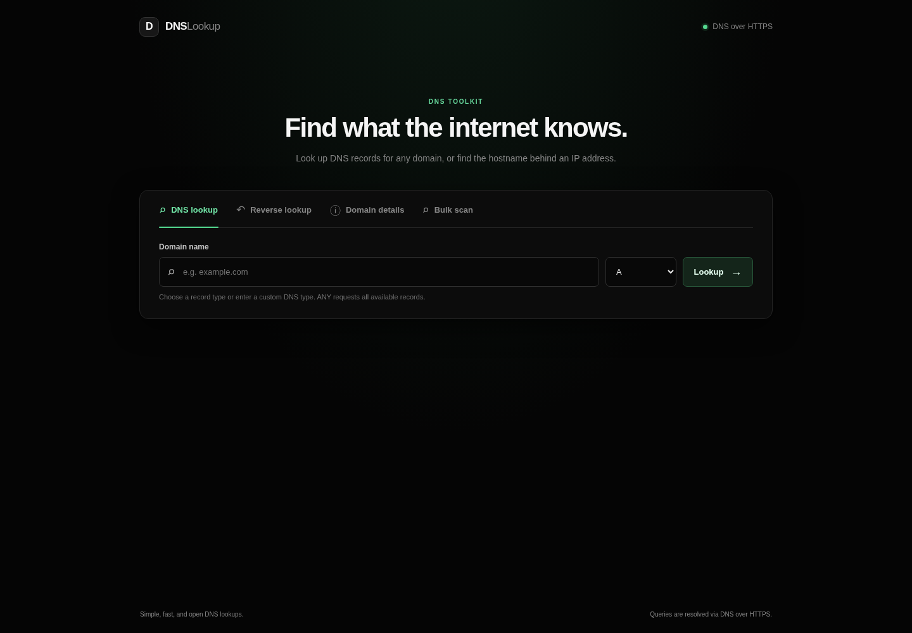
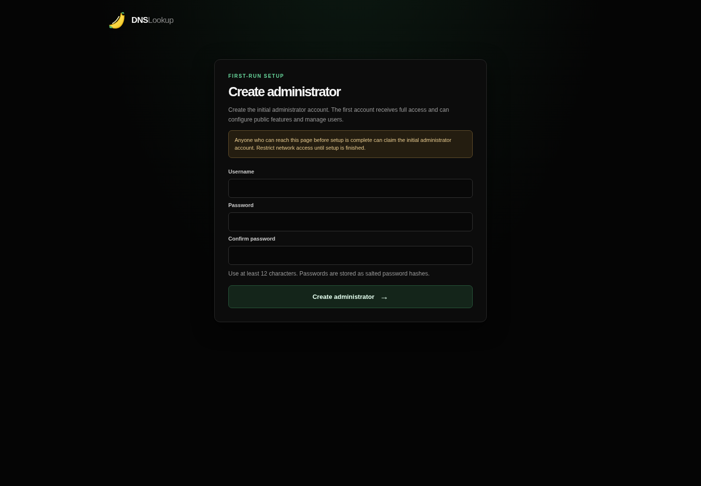
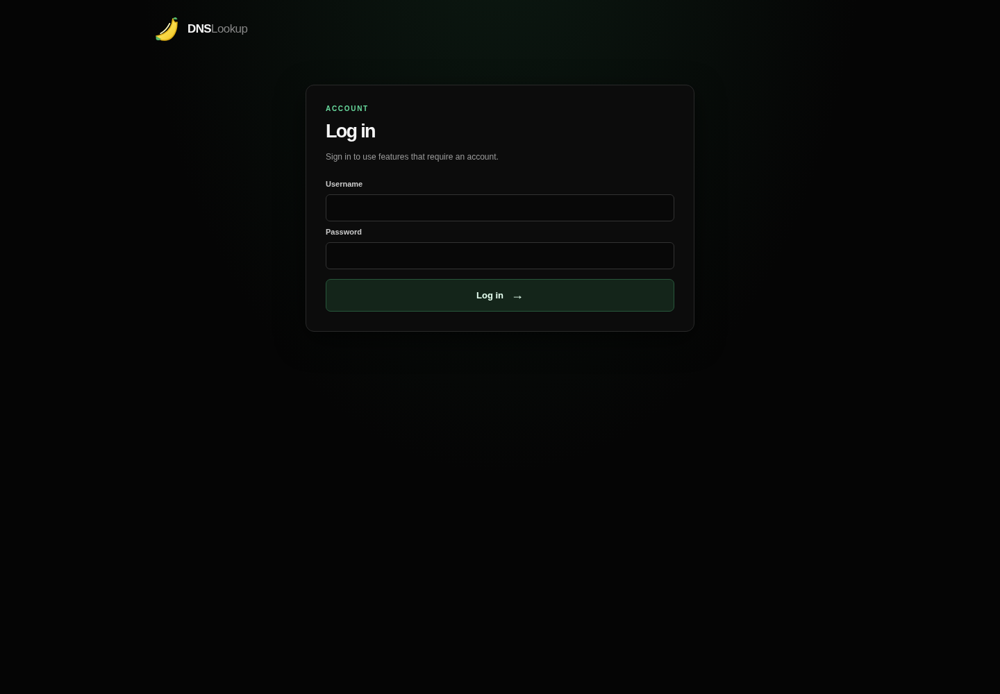
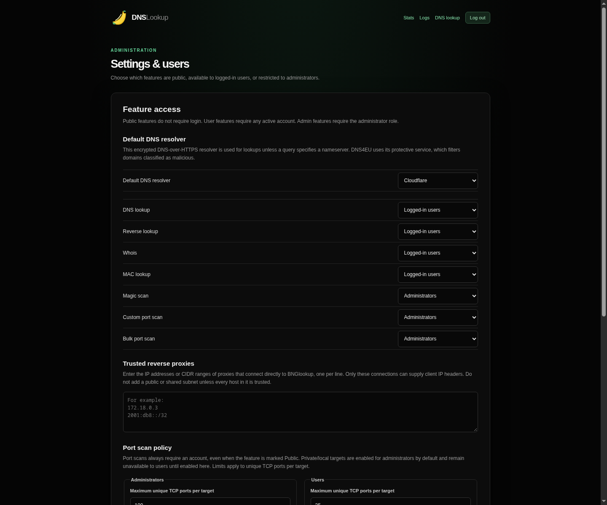
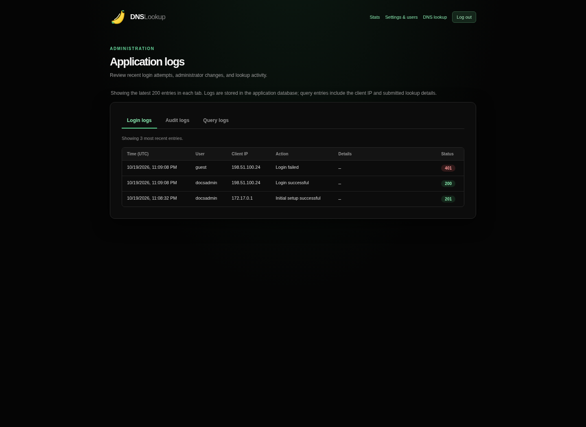
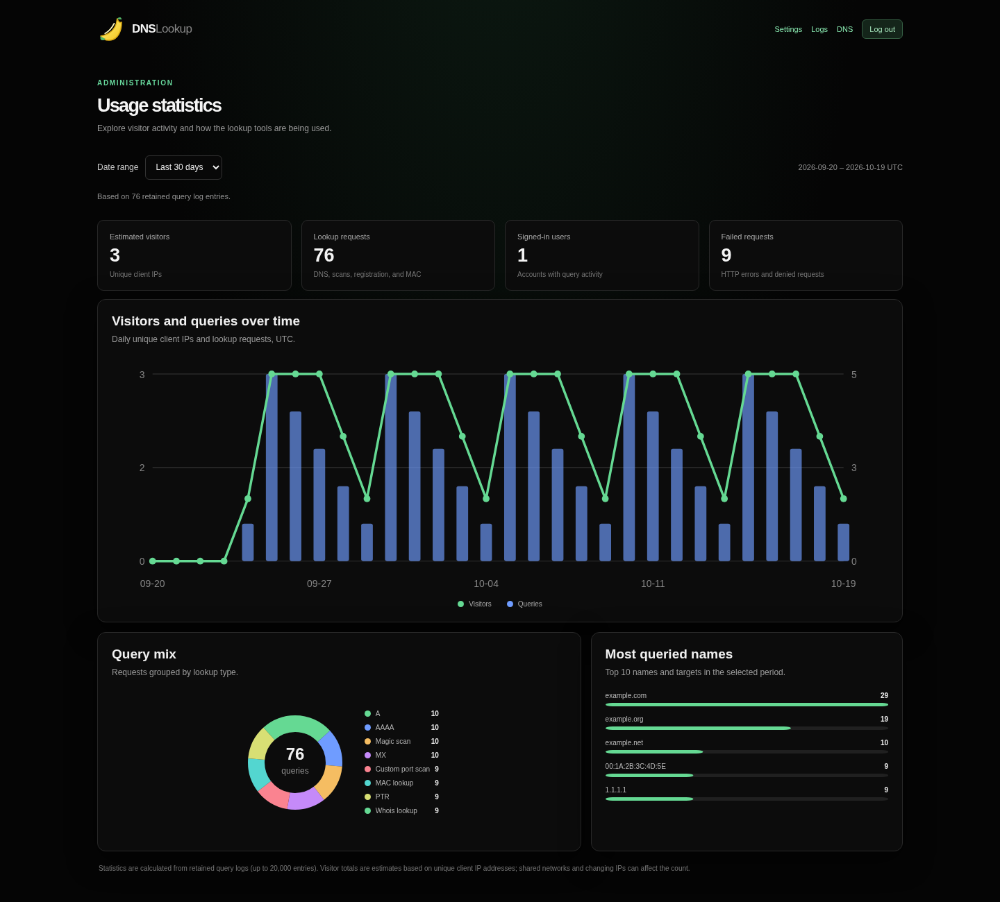

# BNGlookup

A lightweight, self-hosted DNS lookup web interface for querying DNS records and
reverse DNS (PTR) records for IPv4 and IPv6 addresses.

## Features

- Query common DNS records: A, AAAA, ANY, CAA, CNAME, HTTPS, MX, NS, PTR, SOA,
  SRV, SSHFP, SVCB, TLSA, and TXT.
- Query other record types by name or numeric DNS type code.
- Use the unified search bar to detect domains/URLs, IPv4/IPv6 addresses, and
  MAC addresses and automatically select DNS, reverse DNS, or vendor lookup.
- Let administrators send DNS, reverse DNS, and Magic scan queries to a
  specific nameserver IP or hostname, with optional non-standard port selection.
- Let administrators choose the default encrypted DNS-over-HTTPS resolver:
  Google Public DNS, Cloudflare, Quad9, or DNS4EU (EU).
- Look up the registered vendor and address attributes for a MAC address.
- Check whether a remote host is up with an ICMP ping (4 echo requests, with
  packet loss and round-trip times) or an HTTP/HTTPS GET request (status code,
  response time, redirect target, and TLS trust).
- Scan a domain and common subdomains for DNS records, cloud-provider
  endpoints, WHOIS/RDAP registration data, SPF policies, and common DKIM
  selectors, with IP geolocation and country information for returned IPs.
- Optionally scan 26 common TCP ports on up to eight eligible domain IP
  addresses, subject to the signed-in user's local-target policy.
- Run a custom TCP port list/range against one domain or IP, or run a bounded
  single-port scan against an explicit IP list or CIDR block.
- Look up PTR records from IPv4 or IPv6 addresses.
- Look up public IPv4/IPv6 registration data from RDAP (IP WHOIS), including
  network range and CIDR subnet, AS number, registry handle, country, dates,
  status, and published contacts. IP WHOIS also appears under reverse DNS and
  automatic IP lookups (when Whois access is permitted), and for your own IP on the home page.
- Display the visitor's public IP address, PTR record, and IP registration
  details on the landing page.
- Display PTR hostnames for IP addresses returned in DNS results and for
  resolved nameserver addresses.
- View public domain registration details from RDAP (the modern WHOIS service),
  including registrar, registration dates, status, and published contacts.
- Compare nameservers from registration data with live DNS NS answers, including
  available IP addresses and TTLs.
- View DNS response status and answer, authority, and additional records.
- Navigate everything from one tabbed header: all lookup tools, plus Stats, Logs
  and Admin for administrators, on every page.
- Search and sort DNS and Magic scan result tables, and click result values to
  copy them to the clipboard.
- Review login attempts, administrator actions, and DNS/scan lookup activity in
  the administrator's tabbed logs page.
- View visitor and query statistics with daily activity charts, query-type pie
  charts, and most-queried names in the administrator dashboard.
- Create the initial administrator through first-run setup; manage user roles,
  account status, password resets, and access to each lookup feature.
- Configure the default DNS-over-HTTPS resolver, trusted reverse proxies, and
  role-specific port-scan limits and local-network permissions in the admin
  panel.
- Customize the site title and browser/header icon from the administrator
  settings. Icons can be uploaded as PNG, JPEG, GIF, WebP, or ICO (up to
  256 KB), or loaded from an HTTPS URL.
- Obtain and renew a free SSL certificate for the web interface with the
  built-in ACME (Let's Encrypt) client, using the HTTP-01 challenge.
- Apply daily per-IP limits to public lookups and use secure, expiring
  authenticated sessions.
- Run as a small Docker container, with no application dependencies to install.

## Screenshots

The lookup modes share the home page; the other screenshots show each separate
setup, account, and administrator page. Log and statistics screenshots use
illustrative sample data.

<table>
  <tr>
    <td align="center"><strong>Lookup tools</strong><br></td>
    <td align="center"><strong>First-run administrator setup</strong><br></td>
  </tr>
  <tr>
    <td align="center"><strong>Login</strong><br></td>
    <td align="center"><strong>Settings and access policies</strong><br></td>
  </tr>
  <tr>
    <td align="center"><strong>Application logs</strong><br></td>
    <td align="center"><strong>Usage statistics</strong><br></td>
  </tr>
</table>

## Installation with Docker Compose

### Requirements

- Docker Engine
- Docker Compose v2 (`docker compose`)

### Build and start

From the repository directory, build the image and start the service:

```sh
docker compose up --build -d
```

Open [http://localhost:3000](http://localhost:3000) in your browser.

To use a different host port, set `PORT` when starting Compose. For example,
this maps host port 8080 to the app's container port 3000:

```sh
PORT=8080 docker compose up --build -d
```

View the application logs or stop the service with:

```sh
docker compose logs -f
docker compose down
```

### Deploy on a clean Ubuntu 24.04 minimal install

Run these commands as a user with `sudo` rights. They install Docker from the
official repository, fetch the project, and start it.

```sh
# 1. Install prerequisites and Docker Engine with the Compose plugin
sudo apt-get update
sudo apt-get install -y ca-certificates curl git
sudo install -m 0755 -d /etc/apt/keyrings
sudo curl -fsSL https://download.docker.com/linux/ubuntu/gpg -o /etc/apt/keyrings/docker.asc
sudo chmod a+r /etc/apt/keyrings/docker.asc
echo "deb [arch=$(dpkg --print-architecture) signed-by=/etc/apt/keyrings/docker.asc] https://download.docker.com/linux/ubuntu $(. /etc/os-release && echo "$VERSION_CODENAME") stable" | sudo tee /etc/apt/sources.list.d/docker.list > /dev/null
sudo apt-get update
sudo apt-get install -y docker-ce docker-ce-cli containerd.io docker-buildx-plugin docker-compose-plugin
sudo systemctl enable --now docker

# 2. Get the project
git clone https://github.com/BANAANGA/BNGlookup.git
cd BNGlookup

# 3a. Start on port 3000 only (HTTP, no certificate)
sudo docker compose up --build -d

# 3b. OR start with ports 80 and 443 mapped (needed for the ACME certificate)
sudo docker compose -f compose.yaml -f compose.acme.yaml up --build -d

# 4. (Optional) open the firewall if ufw is enabled
sudo ufw allow 80/tcp
sudo ufw allow 443/tcp

# 5. Check that it is running
sudo docker compose ps
sudo docker compose logs -f
```

Use either 3a or 3b, not both. Option 3b publishes host port 80 to the app
(HTTP, and the ACME challenge) and host port 443 to the app's HTTPS listener
(port 8443 in the container). Port 443 only answers after a certificate has been
issued; see [SSL certificate (ACME)](#ssl-certificate-acme).

#### Update to a new version

Your accounts, settings, logs, and certificates live in the `app_data` Docker
volume, so they are kept when you update. Run from the `BNGlookup` directory,
using the same compose files you started with:

```sh
cd ~/BNGlookup

# Optional: back up the data volume first
sudo docker run --rm -v bnglookup_app_data:/data -v "$PWD":/backup alpine \
  tar czf /backup/bnglookup-data-$(date +%F).tar.gz -C /data .

# Fetch the latest code and rebuild
git pull
sudo docker compose -f compose.yaml -f compose.acme.yaml up --build -d   # or without -f if not using ports 80/443

# Remove old, unused images and confirm the new version is running
sudo docker image prune -f
sudo docker compose ps
sudo docker compose logs --tail 50
```

The volume name is `<project folder>_app_data` (lowercase), for example
`bnglookup_app_data`; check it with `sudo docker volume ls`. To pin a specific
release, run `git fetch --tags && git checkout v1.1` before rebuilding, and
`git checkout main && git pull` to return to the latest code. To roll back, check
out the previous tag or commit and rebuild.

Other useful commands:

```sh
sudo docker compose restart        # restart without rebuilding
sudo docker compose down           # stop and remove the container (keeps data)
sudo docker compose down -v        # stop AND delete all data (irreversible)
```

Ports 80 and 443 must be free on the host (stop any web server using them), and
the host's firewall or cloud security group must allow them. Before creating the
administrator account, make sure only trusted people can reach the server.

### Configure the DNS resolver

After creating the administrator account, open **Settings & users** and choose
the default resolver: Google Public DNS, Cloudflare, Quad9, or DNS4EU (EU). The
setting is stored in SQLite and applies to DNS, reverse DNS, Magic scan, and
nameserver lookups unless an individual query specifies a nameserver. DNS query
names and record types are sent to the selected provider.
The DNS4EU option uses its [protective resolver](https://joindns4.eu/for-public),
which may filter domains classified as malicious.

## Accounts, roles, and feature access

The first time the app starts with an empty data volume, it opens a one-time
setup page for creating the administrator username and password. Passwords
must be at least 12 characters and are stored as salted scrypt hashes. **Before
creating the first administrator, restrict access to the app to a trusted
network.** Whoever reaches the setup page first can create the initial admin.

The administrator can create and manage user accounts, assign the Admin or
User role, disable accounts, reset passwords, and set each feature to **Public**,
**Logged-in users**, or **Administrators**. By default DNS lookup, reverse
lookup, Whois, MAC lookup, and Ping require a logged-in user; Magic scan and both
port-scan tools require an administrator. Public access can be enabled or
changed from the admin panel. Sessions use HttpOnly, SameSite cookies and expire
after 12 hours.

Administrators can open **Logs** from **Settings & users** to view login
attempts (including failures and sign-outs), successful administrator changes,
and lookup/scan requests in separate tables. Each tab shows the latest 200
entries; up to 20,000 total log records are retained in the SQLite database on
the `app_data` volume. Query logs include the client IP,
account when signed in, submitted query details, and HTTP status. Treat the
database and its backups as sensitive operational data.

The **Stats** page summarizes query-log data for the last 7, 30, or 90 days. It
shows estimated unique visitors (based on client IP), signed-in accounts with
query activity, request failures, daily visitor/query charts, query-type
distribution, and frequently queried names. Statistics reflect the retained
query logs, so older activity may not be included after the 20,000-entry limit
is reached.

Unauthenticated requests to features marked **Public** are limited to 15 lookup
requests per client IP address per UTC day. The counter resets at 00:00 UTC and
is stored in SQLite so it survives application restarts. Logged-in users are
not subject to this guest quota. When deployed behind a reverse proxy, the app
uses the connection address it sees unless the immediate proxy is explicitly
trusted in **Settings & users → Trusted reverse proxies**. Enter one IP address
or CIDR range per line. When a trusted proxy is configured, the app uses its
`CF-Connecting-IP`, `X-Real-IP`, or `X-Forwarded-For` client address for display,
public lookup quotas, and login-attempt limits. The setting is applied
immediately and persisted in SQLite.

For initial setup, or to pre-populate the administrator setting on a new
database, set `TRUSTED_PROXIES` to the reverse proxy's exact IP address or CIDR
subnet in the app's container network:

```sh
TRUSTED_PROXIES=172.18.0.3 docker compose up -d --build
```

The admin panel setting takes precedence over the environment value after it
has been stored. Configure only proxy addresses that connect directly to
BNGlookup; do not trust the entire Internet (`0.0.0.0/0` or `::/0`). The trusted
proxy must overwrite or safely append the forwarding headers so clients cannot
spoof them. With an empty trusted-proxy setting, forwarded headers are ignored.

The administrator can select Google Public DNS, Cloudflare, Quad9, or DNS4EU
(EU) as the default encrypted DNS-over-HTTPS resolver. The choice is persisted
with the other application settings.

SQLite stores users, feature-access settings, sessions, and guest quota counters
in the Compose `app_data` volume at `/data/bnglookup.sqlite`. Keep this volume to
preserve accounts and quota state across container replacements, and back it up
with your other application data. To enable the cookie's `Secure` attribute
behind HTTPS, set `COOKIE_SECURE=true` in the deployment environment. Do not
expose the service over an untrusted network without HTTPS.

## SSL certificate (ACME)

Administrators can obtain a trusted certificate for the web interface from
**Admin → SSL certificate**. The built-in client speaks ACME (RFC 8555) to
Let's Encrypt using the HTTP-01 challenge; it needs no external dependencies.

1. Point one or more public DNS names (for example `lookup.example.com`) at the Docker host.
2. Publish port 80 to the app (for validation) and port 8443 as HTTPS.
   Run Compose with `-f compose.yaml -f compose.acme.yaml` (see the Ubuntu deployment steps above). If a reverse proxy
   owns port 80, forward `/.well-known/acme-challenge/` to the app.
3. In the SSL certificate tab enter the domain names (one per line, up to 20; they share a single certificate and each must resolve to this host) and a contact email, accept the
   CA terms, and save. Start with the **Staging** environment (untrusted test
   certificates, generous limits), then switch to **Production**.
4. Click **Request certificate now**. Progress is shown live.

The HTTPS listener (`HTTPS_PORT`, default 8443) starts automatically and is
reloaded without a restart whenever a certificate is issued. With auto-renew
enabled, the certificate is renewed when fewer than 30 days remain. The
certificate, private key, and account key are stored with restrictive
permissions in `/data/acme`, so keep the `/data` volume private and persistent.
Requests over HTTPS get HSTS and Secure cookies automatically.

## Web security and input handling

The server validates input independently of browser-side field limits, rejects
oversized, duplicate, and control-character request parameters, uses strict
UTF-8 decoding for JSON requests, and uses parameterized SQL for account
operations. Static requests can access only an explicit list of required
one-level files; directory paths, file listing, and application files outside
that list are not served. Values from DNS, registration, and log responses are
HTML-escaped before rendering. The interface also sends a restrictive Content
Security Policy and browser security headers. State-changing account requests
require a same-origin `Origin` header; use the web interface or send that header
when calling these endpoints directly.

These safeguards do not replace HTTPS, network-level access controls, or
scanning only systems you are authorized to test. Keep `COOKIE_SECURE=true`
when serving the app behind an HTTPS reverse proxy.

The landing page displays the client IP observed by the application and
performs PTR and RDAP registration lookups when it is public. This sends the
visitor's public IP address to the DNS-over-HTTPS provider for PTR resolution
and to `rdap.org` for registration data. Behind a reverse proxy, set the
proxy's connection address in **Settings & users → Trusted reverse proxies**
so the app can safely use its forwarded client-IP header.

## Deploy with Arcane

Arcane can deploy this repository as a Compose project. Since the Compose file
builds the image from the repository (`build: .`), sync the project files as
well as the Compose file:

1. In Arcane, go to **Customization → Git Repositories** and add
   `https://github.com/BANAANGA/BNGlookup.git`. Configure repository
   authentication if your Arcane setup requires it.
2. Open **Projects** and select **From Git Repo** from the dropdown next to
   **Create Project**.
3. Choose **Pull**, give the project a name, keep **Target Type** set to
   **Project**, and choose **Create a new project**.
4. Select the repository and the `main` branch. Set **Compose File Path** to
   `compose.yaml`.
5. Enable **Sync Files** so Arcane also copies `Dockerfile`, `server.js`, and
   the `public/` assets needed by the image build. Optionally enable
   **Redeploy After Sync** to rebuild and restart the app after repository
   updates.
6. Click **Add Sync**, open the project, and choose **Build & Deploy** to build
   the image and start the service.
7. Open `http://<arcane-host>:3000` in your browser. If Arcane runs on another
   host, make sure its firewall allows inbound traffic on port 3000.

The Compose file publishes port 3000 by default. To use a different host port,
set `PORT` in the project's environment configuration (for example, `PORT=8080`)
and redeploy.

## Run without Docker

Requires Node.js 22 or newer. Clone or download the repository, change to its
directory, and start the server:

```sh
node server.js
```

The interface is available at [http://localhost:3000](http://localhost:3000).
Set `PORT` to change the listening port. To retain support for a custom
DNS-over-HTTPS JSON endpoint, set `DOH_ENDPOINT`; it will appear as an
additional resolver choice in the administrator panel:

```sh
PORT=8080 DOH_ENDPOINT=https://example.net/dns-query node server.js
```

## DNS record notes

Select **Custom…** to enter another record type by name (such as `NAPTR`) or
numeric type code. `ANY` queries do not necessarily return every record; DNS
servers commonly limit their responses. The available records depend on the
queried domain and provider.

In **DNS lookup**, **Reverse lookup**, or **Magic scan**, administrators can
enter a nameserver IP or hostname to send DNS queries directly to that server
over UDP (with TCP fallback for truncated responses). Other users use the
configured default DNS-over-HTTPS provider. A custom port can be provided after the IPv4 address
(`1.1.1.1:53`) or after a bracketed IPv6 address
(`[2606:4700:4700::1111]:53`). Hostnames are resolved using the container's
configured system resolver before querying the selected server.

Choose **Whois** to view publicly available registration information for a
domain or IP address. Domain lookups compare registered nameservers with the
domain's live DNS NS records. Registration data is retrieved from RDAP using
`rdap.org`, which redirects to the responsible registry. The queried domain or
IP address is sent to the RDAP service; contact details may be redacted or
unavailable. For visitors with a public IP address, the landing page also
retrieves and displays that IP's RDAP registration details. If the RDAP record
does not include an AS number, BNGlookup requests it from `ipwho.is`; this
applies to the visitor IP as well as IP addresses submitted to Whois.

The **Magic scan** tool opens by default. It checks A, AAAA, CAA, CNAME, HTTPS,
MX, NS, SOA, SRV, and TXT records for the domain and common subdomains such as
`www`, `mail`, `api`, and `staging`. It also checks common service and
verification names used by AWS/SES, Azure, Google Cloud, Cloudflare, Vercel,
Netlify, Heroku, DigitalOcean, and other providers. The scan also retrieves
public RDAP (WHOIS) registration data for the domain. SPF is identified from
scanned TXT records; DKIM checks common selectors for TXT and CNAME records.
Magic scan additionally queries public Certificate Transparency logs at
`crt.sh` for certificate names under the domain. If that service is unavailable
or returns invalid data, it tries the SSLMate CertSpotter API. It checks up to
25 unique discovered subdomains for A, AAAA, CNAME, and TXT records. This can
find names outside the built-in list but is not exhaustive; certificate names
may be historical or no longer resolve. The queried domain is sent to
`crt.sh`; if it fails, it is also sent to CertSpotter. Either service may be
unavailable or rate-limited.
Returned IP addresses include PTR lookups where available and approximate
geolocation details, including country, city, and region when available.
Public IPs discovered in scan results are sent to the `ipwho.is` geolocation
service; private and reserved IP addresses are not sent. Geolocation may be
unavailable or inaccurate.

Magic scan DNS answers are shown in a searchable, sortable table with host,
record type, TTL, data, PTR, geolocation, and candidate source columns. Click a
result value to copy it. Standard DNS lookup answers, authority, and additional
records use the same table controls. The unified search bar automatically
recognizes domains and URLs, IP addresses for reverse DNS, and MAC addresses
for vendor lookup; the mode tabs remain available for manual lookups.

Enable **Scan common TCP ports** before starting a Magic scan to check the
domain's A/AAAA addresses for 26 commonly used TCP ports, including ports 2222
and 8443. Results identify the scanned domain and IP address. The check is
optional and limited to eight eligible IP addresses. Private/local addresses
are scanned only when enabled for the signed-in user's role in the admin panel;
other reserved addresses are always skipped. It reports ports that accepted a
TCP connection; it is not a vulnerability assessment. Only scan systems you
are authorized to test.

The **Port scan** tab checks a comma-separated list of ports and/or
ranges (for example, `22,80,443,8000-8010`) on one domain or IP address. The
administrator configures the maximum number of unique ports per target
separately for Admin and User roles, from 1 to 65,535. Defaults are 100 ports
for Admins and 25 for Users. Scans resolve at most eight eligible IP addresses.
The **Bulk port scan** tab
checks one TCP port across an explicit IPv4/IPv6 list or CIDR blocks, capped at
256 unique addresses. All port-scan features require a signed-in account,
regardless of the public feature-access setting. Administrators can separately
allow or disallow private/local targets for each role; by default this is
enabled for Admins and disabled for Users. Other reserved addresses are always
skipped. Bulk scanning is intentionally bounded rather than an unrestricted
internet-wide scan. Only scan systems you are authorized to test.

DKIM selector checks use a built-in candidate list. DNS cannot list every
subdomain or a domain's custom DKIM selectors, so scan results may not include
every configured record.

Choose **MAC lookup** to normalize a MAC address and retrieve its registered
vendor, OUI block, and address classification (unicast/multicast and
universally/locally administered). Vendor data is provided by `maclookup.app`;
the submitted MAC address is sent to that external service.

Choose **Ping** to check whether a host is up. **ICMP ping** sends four echo
requests from the server and reports packet loss and round-trip times; **HTTP**
and **HTTPS** send a single GET request to `/` (redirects are reported, not
followed). Use a GET check for hosts that block ICMP. Private and reserved
addresses are refused unless local-network access is enabled for your role.
ICMP from the container works with Docker's default settings; if your runtime
disables unprivileged ICMP, add `cap_add: [NET_RAW]` to the Compose service.
