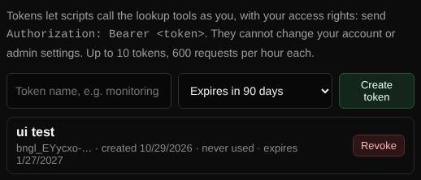

# API tokens

Lets scripts and other systems use the lookup tools with your access rights.

| | |
| --- | --- |
| **Where** | **My account** → **API tokens** |
| **Default access** | Logged-in users |



## Create a token

1. On **My account**, enter a name for the token (for example the script that
   will use it) and choose when it expires (30, 90 or 365 days, or never).
2. Click **Create token** and copy it; it is shown only once.

## Use it

Send the token in the `Authorization` header:

```sh
curl -H "Authorization: Bearer bngl_..." \
  "https://lookup.example.com/api/lookup?name=example.com&type=MX"
```

## What a token can do

| Allowed | Not allowed |
| --- | --- |
| The lookup tools (DNS, Email check, Web check, Reputation, …) and the Monitors API, with the access rights of your account | Your account settings, two-factor login, tokens, history, share links and all admin functions |

## Good to know

- Each token is limited to 600 requests per hour.
- Tokens are stored only as hashes. **Revoke** stops a token immediately.
- Requests made with a token are logged under your account.

---

[← Back to the wiki](README.md)
