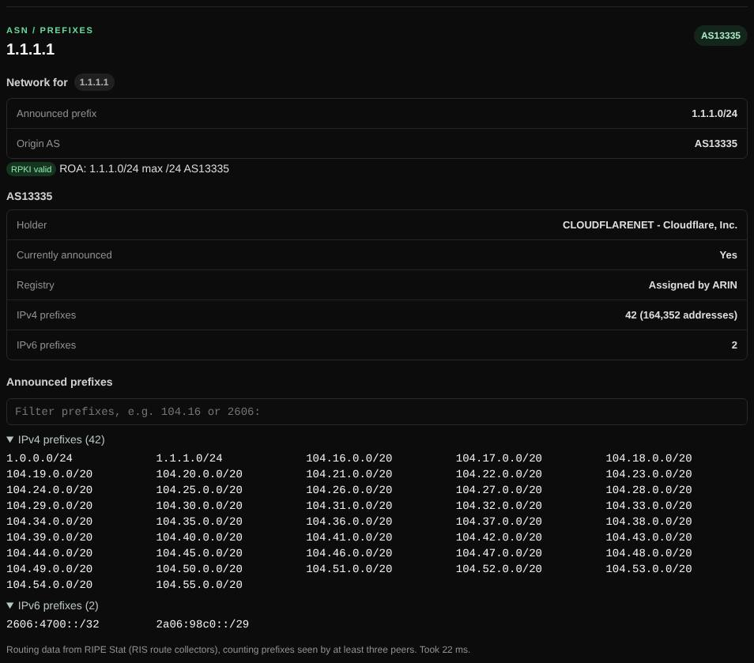

# ASN

Shows which network (autonomous system) announces an IP address, and every IP range that network announces.

| | |
| --- | --- |
| **Where** | **ASN** tab |
| **Default access** | Logged-in users |

## What it does

Answers "who runs this IP?" at the routing level: the announced prefix, the
origin AS and its holder, the prefix's RPKI validity, and all IPv4 and IPv6
prefixes the AS announces.

## How it works

1. A domain is resolved to an address; an AS number (`AS13335`) can also be entered directly.
2. Routing data comes from RIPE Stat: the covering prefix, origin AS, RPKI status
   and announced prefixes (seen by at least three RIPE RIS peers).
3. Results are cached for 10 minutes.

## What it shows

| Field | Meaning |
| --- | --- |
| Prefix and origin AS | The route that covers the address |
| RPKI | **Valid**: the announcement is authorized by a signed ROA; **Invalid**: possible hijack or misconfiguration |
| Announced prefixes | Up to 3,000 per address family, with a filter |

---

[← Back to the wiki](README.md)
