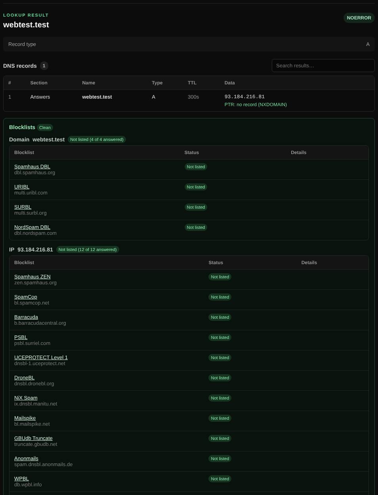

# Auto lookup

Type anything and BNGlookup picks the right tool: a domain or URL runs a DNS lookup, an IP address a reverse lookup, and a MAC address a vendor lookup.

| | |
| --- | --- |
| **Where** | **Auto lookup** tab (the default tab) |
| **Default access** | Logged-in users (follows the DNS lookup, Reverse lookup and MAC lookup settings) |

## What it does

Auto lookup saves you from choosing a tool. It recognizes what you typed and
runs the matching lookup:

| You enter | It runs |
| --- | --- |
| A domain name or URL (`example.com`, `https://example.com/page`) | [DNS lookup](dns-lookup.md) of the A record |
| An IPv4 or IPv6 address | [Reverse lookup](reverse-lookup.md) (PTR) with the address's registration |
| A MAC address (`00:1A:2B:3C:4D:5E`) | [MAC lookup](mac-lookup.md) |

For signed-in users, a [blocklist check](blocklists.md) of the domain or IP is
added below the result.

## How it works

1. The input is trimmed; a URL is reduced to its host name.
2. The value is classified as MAC, IPv4, IPv6 or domain. A hint below the field
   shows what was detected before you submit.
3. The matching tool runs with its own access rules. If that tool is restricted
   for your account, you are asked to log in or told it is restricted.

## Good to know

- The quick search box on the admin pages uses Auto lookup too.
- To query another record type, use [DNS lookup](dns-lookup.md).

---

[← Back to the wiki](README.md)
