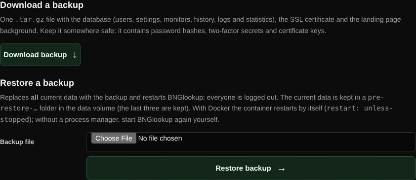
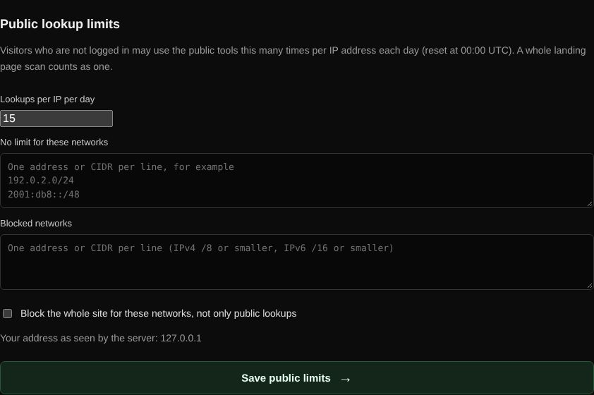

# Backup and public limits

Back up and restore all data from the admin page, and control how much visitors without an account may use the public tools.

| | |
| --- | --- |
| **Where** | Admin → Backup; Admin → Access & network |
| **Access** | Administrators |

## Backup and restore

**Download backup** creates a `.tar.gz` with:

- a consistent snapshot of the database: users, settings, monitors, history,
  shared links, logs and statistics;
- the SSL certificate and its key;
- the landing page background.

It contains password hashes, two-factor secrets and keys: keep it safe.

**Restore backup** replaces all data:

1. The upload is checked: it may only contain the files a backup contains, and the
   database must be an intact BNGlookup database with at least one administrator.
2. BNGlookup restarts and swaps the files in before it opens the database.
   Everyone is logged out.
3. The replaced data is kept in `pre-restore-<time>/` in the data volume (the last
   three are kept).

With Docker the container restarts by itself (`restart: unless-stopped`); the
page reloads to the login page when BNGlookup is back. Without a process manager,
start BNGlookup again yourself.

## Public lookup limits

In **Admin → Access & network**:

| Setting | Effect |
| --- | --- |
| Lookups per IP per day | How many public lookups a visitor without an account may make per UTC day (15 by default). A landing page scan counts as one. |
| No limit for these networks | Addresses or CIDRs (one per line) that may use public tools without a limit, for example your office. |
| Blocked networks | Addresses or CIDRs that may not use public tools (IPv4 /8 or smaller, IPv6 /16 or smaller). |
| Block the whole site | Blocked networks get no access at all. Refused if it would include your own address. |

The tab shows the address the server sees for you; behind a reverse proxy, set up
the trusted proxies first so the real visitor address is used.
