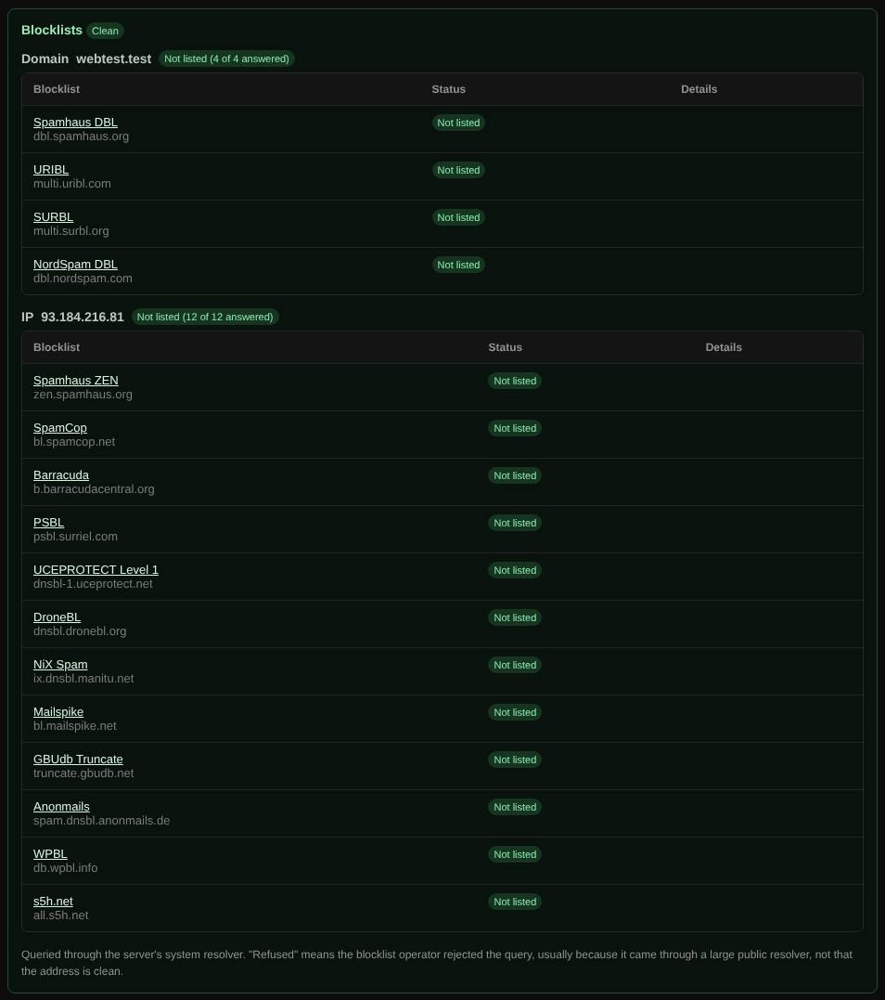

# Blocklists

Checks whether a domain or its IP addresses are listed on common spam and abuse blocklists (DNSBLs).

| | |
| --- | --- |
| **Where** | [Magic scan](magic-scan.md), below [Auto lookup](auto-lookup.md) results, and in [Reputation](reputation.md) |
| **Default access** | Logged-in users |

## What it does

Mail servers refuse or junk mail from listed domains and addresses. This check
tells you whether you are listed, where, and why.

## How it works

1. The domain is looked up in domain blocklists, and up to four of its public
   IPv4 addresses in IP blocklists, using DNS queries.
2. A listing returns an address in the `127.0.0.x` range and usually a TXT record
   with the reason, which is shown.

| Lists | |
| --- | --- |
| Domain | Spamhaus DBL, URIBL, SURBL, NordSpam DBL |
| IPv4 | Spamhaus ZEN, SpamCop, Barracuda, PSBL, UCEPROTECT L1, DroneBL, NiX Spam, Mailspike, GBUdb, Anonmails, WPBL, s5h.net |

## Results

| Status | Meaning |
| --- | --- |
| **Listed** | On the list; the reason and a link to the list are shown. |
| **Not listed** | Not on the list. |
| **Refused** | The list refused the query (common through large public resolvers), so the status is unknown. |

## Good to know

- Queries use the container's system resolver, because Spamhaus, URIBL and SURBL
  refuse queries from public resolvers. For reliable results, an administrator
  can set `BLOCKLIST_RESOLVER` to an own recursive resolver.
- IPv6 addresses are not checked; few lists cover them.

---

[← Back to the wiki](README.md)
