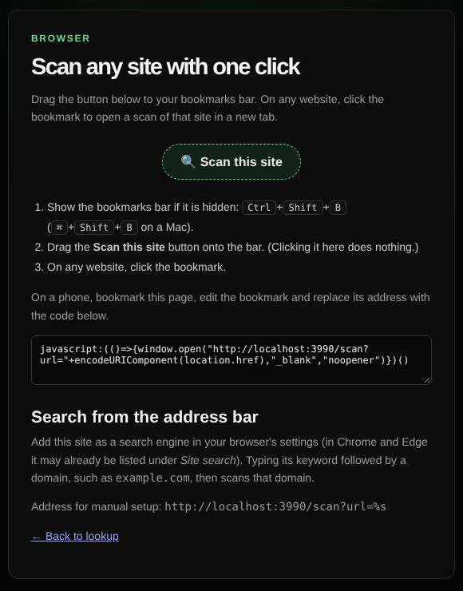

# Scan from your browser

Scan any website you visit with one click, or from the browser's address bar.

| | |
| --- | --- |
| **Where** | `/bookmarklet` (linked from the landing page and My account) |
| **Access** | Everyone; the scan uses the tools the visitor may use |

## Bookmarklet

Drag the **Scan this site** button to the bookmarks bar. On any website, click
the bookmark: a new tab opens with a scan of that site's host name. Signed-in
users get the simple or the full interface, following their Simple / Full choice;
other visitors get the landing page.

On a phone, bookmark the page, edit the bookmark and replace its address with
the code shown on the page.

## Address bar search

The site publishes an OpenSearch description (`/opensearch.xml`), so browsers can
add it as a search engine. Typing its keyword followed by a domain then scans that
domain. For manual setup use `https://<your-site>/scan?url=%s`.

`/scan?url=<address or domain>` also works as a direct link, for example from
other tools or a wiki.
