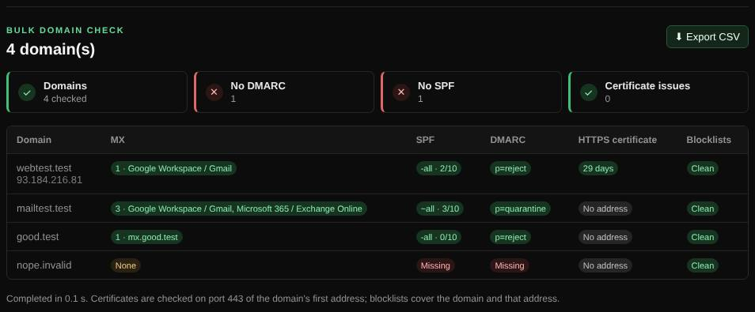

# Bulk check

Checks the basics of up to 50 domains at once and exports the table as CSV.

| | |
| --- | --- |
| **Where** | **Bulk check** tab |
| **Default access** | Administrators |

## What it does

Useful for agencies and IT teams with many domains: one table with the mail
setup, certificate and blocklist status of each domain.

## What it checks per domain

| Column | Details |
| --- | --- |
| MX | Number of mail servers and the provider |
| SPF | Found, `all` qualifier, DNS lookup count |
| DMARC | Found and policy |
| HTTPS certificate | Trusted and days until expiry, on port 443 of the first address |
| Blocklists | Listings of the domain and that address |

## Input and limits

- Up to 50 domains, separated by new lines, spaces or commas; invalid entries are skipped.
- Five domains are checked at a time, one bulk check per server at a time.
- **Export CSV** downloads the results for a spreadsheet.

---

[← Back to the wiki](README.md)
