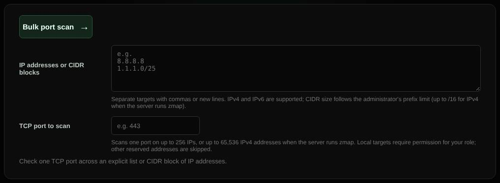

# Bulk port scan

Checks one TCP port across many addresses, up to a /16 network with the optional zmap engine.

| | |
| --- | --- |
| **Where** | **Bulk port scan** tab |
| **Default access** | Administrators |

## What it does

Answers questions such as "which of my servers still have port 3389 open?" across
a list of addresses or whole networks.

## Engines

| Engine | Range | How |
| --- | --- | --- |
| TCP connect (default) | Up to 256 addresses (IPv4 and IPv6) | A normal connection attempt to each address |
| zmap (opt-in) | IPv4 up to /16 (65,536 addresses) | Raw SYN packets at an administrator-set rate (default 10,000 per second); only open hosts are listed |

## Input and limits

- Addresses and CIDR blocks separated by commas or new lines, and one port.
- The largest accepted CIDR is set by an administrator (default IPv4 /24, IPv6 /120).
- One zmap scan runs at a time. Always requires a login.

## Good to know

zmap needs extra container permissions (`compose.zmap.yaml`), and high rates can
trigger your hosting provider's abuse detection. Only scan networks you are
authorized to test.

---

[← Back to the wiki](README.md)
