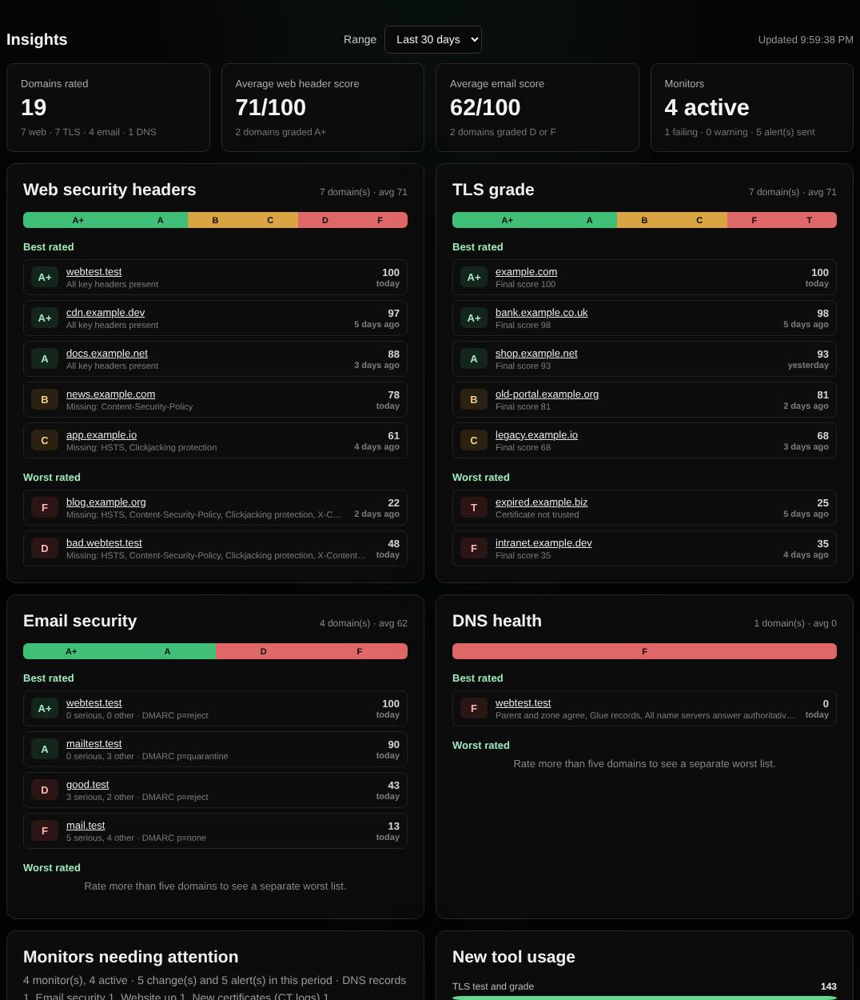

# Dashboard

Live server status, recent activity and insights: the best and worst rated domains, monitors needing attention and takeover risks.

| | |
| --- | --- |
| **Where** | **Admin → Dashboard** |
| **Default access** | Administrators |

## What it shows

**Live status** (refreshed every 3 seconds): CPU, memory, storage, system load,
queries and visitors over 24 hours, the most used tools, the latest queries, and
the running version with a banner when a new release is available.

**Insights** (7, 30 or 90 days, refreshed every minute):

| Panel | Details |
| --- | --- |
| Summary | Domains rated, average web header and email scores, active monitors and alerts |
| Best and worst rated domains | For web security headers, TLS grade, email security and DNS health, with a grade distribution |
| Monitors needing attention | Failing or warning monitors, with owner and last change |
| New tool usage | How often each of the newer tools was used |
| Subdomain takeover risks | Dangling CNAMEs found by Magic scans |

## Where the ratings come from

Every [Web check](web-check.md), [TLS test](sslscan.md), [Email check](email-check.md)
and [DNS health](dns-health.md) check stores the latest grade per domain for 180
days. The email score is 100 minus 15 per serious, 6 per medium and 2 per minor finding.

---

[← Back to the wiki](README.md)
