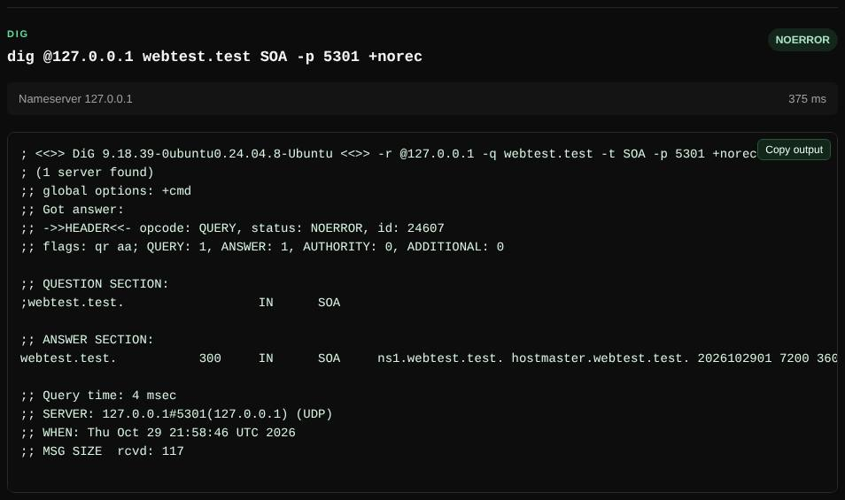

# Dig

Runs a real `dig` command, for when you need raw DNS output, flags, a specific server or a trace.

| | |
| --- | --- |
| **Where** | **Dig** tab |
| **Default access** | Logged-in users |



## What it does

Gives you the familiar `dig` output for one query, without shell access to the
server. Useful to check a specific name server, see flags such as `aa` (authoritative),
or follow a delegation with `+trace`.

## How it works

1. The command is parsed and validated against an allowlist; it is never passed to a shell.
2. The `dig` binary in the container runs the query and its output is shown as is.

## Syntax

```text
[@server] name [type] [class] [+options] [flags]
dig @1.1.1.1 example.com MX +short
dig example.com TXT +dnssec
dig -x 8.8.8.8
dig example.com +trace
```

| Allowed | Examples |
| --- | --- |
| Flags | `-t` type, `-c` class, `-q` name, `-x` reverse, `-p` port, `-4`, `-6`, `-u` |
| Options | `+short`, `+dnssec`, `+trace`, `+tcp`, `+nsid`, `+subnet=`, `+norec`, `+noall +answer`, … |

## Limits

- `+time` up to 10 s, `+tries` up to 3, 30 s in total and 256 KB of output.
- File, key and bind-address flags (`-f`, `-k`, `-y`, `-b`) are rejected.
- A private `@server` is only allowed if your role may reach local networks.
  Without `@server`, the container's own resolver is used.

---

[← Back to the wiki](README.md)
