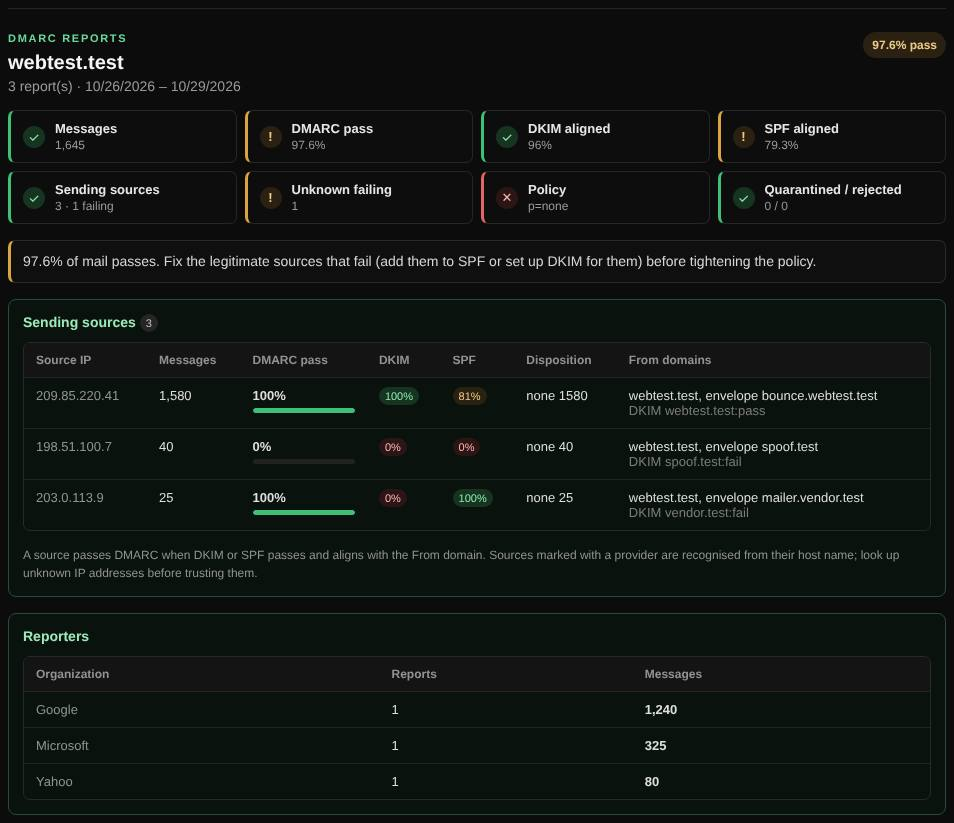

# DMARC reports

Reads the DMARC aggregate reports that mailbox providers send to your `rua` address and shows who sends mail as your domain and whether it passes.

| | |
| --- | --- |
| **Where** | **Email** tab → **DMARC reports** |
| **Default access** | Logged-in users |

## What it does

Before moving DMARC to `p=reject`, you need to know every service that sends mail
for your domain. Aggregate reports contain exactly that, but as XML. This viewer
summarizes any number of them.

## How it works

1. Select up to 50 report files (`.xml`, `.xml.gz` or `.zip`) as received from
   Google, Microsoft, Yahoo and others.
2. The files are unpacked and parsed **in your browser**. Only the sending IP
   addresses are sent to the server, to look up their host names and providers.
3. Results are combined by sending source.

## What it shows

| Section | Details |
| --- | --- |
| Totals | Messages, DMARC pass rate, DKIM and SPF alignment, quarantined and rejected mail |
| Verdict | Whether the domain is ready for a stricter policy |
| Sending sources | Each IP with host name and provider, message count, pass rate, DKIM, SPF, disposition and From domains |
| Reporters | Which organizations sent reports, and how many messages they covered |

## Good to know

A source passes DMARC when DKIM or SPF passes **and** aligns with the From
domain. Unknown failing sources may be forgery, or one of your own services that
still needs SPF or DKIM.

---

[← Back to the wiki](README.md)
