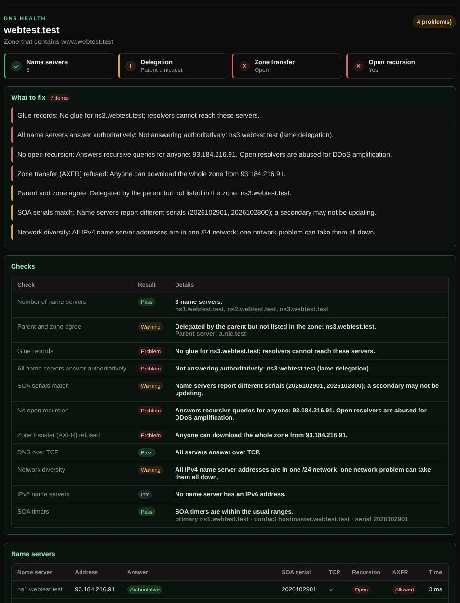

# DNS health

Checks the name servers of a domain directly for delegation errors, lame servers, out-of-sync copies, open zone transfers and open recursion.

| | |
| --- | --- |
| **Where** | **Security** tab → **DNS health**; also a [Magic scan](magic-scan.md) option |
| **Default access** | Logged-in users |

## What it does

A domain can resolve fine for you while one of its name servers is broken,
out of date or misconfigured, causing intermittent failures for others. DNS
health asks every name server itself instead of going through a resolver.

## How it works

1. The zone is found through its SOA record (a subdomain is checked as part of its zone).
2. A server of the **parent zone** (for example `.com`) is asked which name
   servers and glue records it delegates the zone to.
3. Every name server (up to 8, two addresses each) is queried **directly**,
   without recursion, for the zone's SOA and NS records over UDP and TCP.
4. Each server is also sent a recursive query for another domain and a zone
   transfer (AXFR) request, to see whether it answers strangers.

## What it checks

| Check | Problem when |
| --- | --- |
| Number of name servers | Fewer than two; one outage takes the domain offline |
| Parent and zone agree | The parent delegates to servers the zone does not list, or the other way round |
| Glue records | Name servers inside the zone have no glue at the parent, so resolvers cannot find them |
| Authoritative answers | A server is silent or answers without authority (lame delegation) |
| SOA serials match | Servers report different serials; a secondary is not updating |
| Open recursion | A server resolves other domains for anyone; such servers are abused for DDoS amplification |
| Zone transfer (AXFR) | Anyone can download the entire zone |
| DNS over TCP | A server does not answer over TCP; large answers (DNSSEC) fail |
| Network diversity | All IPv4 name servers are in one /24 network |
| IPv6 | No name server has an IPv6 address (informational) |
| SOA timers | Refresh, retry, expire or negative-cache values outside the usual ranges |

## Good to know

- Only public name server addresses are queried. The owners of the name servers
  may see the zone transfer and recursion probes in their logs.
- The result is rated A+ to F on the admin [dashboard](dashboard.md).

---

[← Back to the wiki](README.md)
