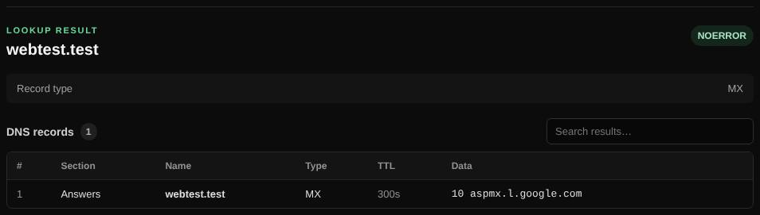

# DNS lookup

Queries one DNS record type for a name through an encrypted DNS-over-HTTPS resolver and shows every answer with its TTL.

| | |
| --- | --- |
| **Where** | **DNS lookup** tab |
| **Default access** | Logged-in users |

## What it does

Looks up records such as A, AAAA, MX, TXT or NS for a domain, the same way a mail
server or browser would, and lists the answers in a sortable, searchable table.

## How it works

1. The query is sent over HTTPS (DoH) to the resolver chosen by the administrator
   (Google, Cloudflare, Quad9, DNS4EU or a custom endpoint).
2. The answers are shown with name, type, TTL and data. Click a value to copy it.
3. Administrators can instead ask a specific name server (for example
   `1.1.1.1:53`) over UDP with a TCP fallback.

## Record types

| Type | Used for |
| --- | --- |
| A / AAAA | IPv4 / IPv6 address of a host |
| CNAME | Alias pointing to another name |
| MX | Mail servers of a domain, with priority |
| TXT | Text records: SPF, DMARC, domain verification |
| NS / SOA | Name servers and the zone's administrative record |
| CAA | Which certificate authorities may issue certificates |
| SRV, HTTPS, SVCB | Service locations and HTTPS hints |
| DNSKEY, DS | DNSSEC keys and their link to the parent zone |
| SSHFP, TLSA | SSH and TLS (DANE) key fingerprints |
| PTR | Reverse DNS (see [Reverse lookup](reverse-lookup.md)) |
| ANY | Everything the server is willing to return (often incomplete) |
| Custom | Any other type by name or number |

Choose **DNSSEC** in the type list for a validation check; see [DNSSEC check](dnssec.md).

## Input and limits

- Domain names, including internationalized names, or a URL (its host is used).
- A custom name server is available to administrators only.

---

[← Back to the wiki](README.md)
