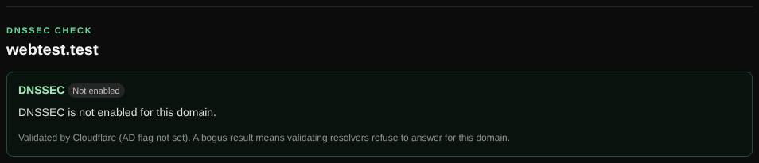

# DNSSEC check

Checks whether a domain is signed with DNSSEC and whether validating resolvers accept the signatures.

| | |
| --- | --- |
| **Where** | **DNS lookup** tab → type **DNSSEC**; also in every [Magic scan](magic-scan.md) |
| **Default access** | Logged-in users |

## What it does

DNSSEC protects DNS answers against forgery with signatures. This check tells
you whether a domain uses it, and whether it is set up correctly; a broken
DNSSEC setup makes the domain unreachable for many users.

## How it works

1. DS, DNSKEY and SOA records are queried through the DoH resolver with the
   DNSSEC (DO) flag set.
2. The resolver's *authenticated data* (AD) flag shows whether it validated the answers.
3. If the resolver fails with SERVFAIL, the query is repeated with checking
   disabled to tell a broken signature apart from other errors.

## Results

| Result | Meaning |
| --- | --- |
| **Secure** | Signed, linked to the parent zone with a DS record, and validated. |
| **Not enabled** | The zone is not signed. |
| **No chain of trust** | The zone is signed, but the parent has no DS record, so validators ignore the signatures. |
| **Validation fails** | Validating resolvers reject the answers; the domain is unreachable for their users. |

## What it checks

- DS records and the DNSKEY key tags they match; KSK and ZSK keys.
- Signature (RRSIG) validity, with a warning when they expire within 7 days.
- Deprecated algorithms, SHA-1 DS digests and DS records that match no key.

## Good to know

A custom name server is not used here, because validation needs a validating resolver.

---

[← Back to the wiki](README.md)
