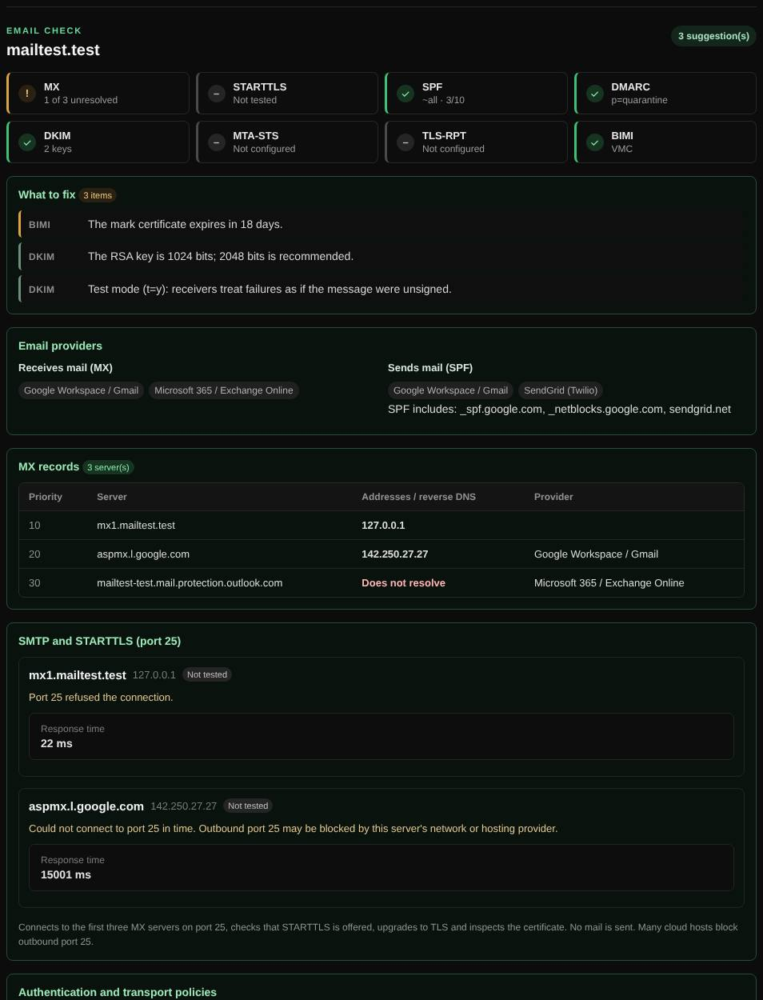

# Email check

Reviews a domain's whole email setup: mail servers and encryption, SPF, DKIM, DMARC, MTA-STS, TLS-RPT and BIMI, and which email providers it uses.

| | |
| --- | --- |
| **Where** | **Email** tab → **Domain check** |
| **Default access** | Logged-in users |

## What it does

Answers "is mail for this domain set up correctly and securely?" The report
opens with a scorecard (one tile per area) and a *What to fix* list sorted by
severity.

## How it works

1. MX records are resolved, with addresses and reverse DNS for each server.
2. The first three MX servers are contacted on **port 25**: the banner is read,
   EHLO is sent, STARTTLS is started and the certificate inspected. No mail is sent.
3. SPF, DMARC, MTA-STS, TLS-RPT and BIMI records are fetched and evaluated, and
   DKIM keys are looked up for common selectors (plus up to five of your own).

## What it checks

| Area | Checks |
| --- | --- |
| MX | Servers exist and resolve; null MX; provider (Google, Microsoft 365, …) |
| STARTTLS | Offered, certificate trusted, name matches, not expiring, TLS 1.2 or newer |
| SPF | One record, at most 10 DNS lookups (RFC 7208), no `+all`, `?all` or `ptr` |
| DKIM | Key present, type and size (RSA ≥ 2048 recommended), not revoked or in test mode |
| DMARC | Present, policy `quarantine` or `reject`, `pct=100`, subdomains protected, reports (`rua`) |
| MTA-STS | TXT record, policy file over HTTPS with a valid certificate, mode `enforce`, MX coverage |
| TLS-RPT | Reporting address for failed encrypted deliveries |
| BIMI | See below |

### BIMI

BIMI shows your logo in supporting inboxes. The check reads `default._bimi`,
fetches the logo (`l=`) and validates it against the SVG Tiny Portable/Secure
profile, reads the mark certificate (`a=`, VMC or CMC: mark type, organization,
trademark, issuer, domains, expiry), compares the logo embedded in the
certificate with `l=`, and checks that DMARC is enforced, which BIMI requires.

## Input and limits

- A domain or an email address (its domain is used). DKIM selectors are optional;
  find yours in the `s=` tag of a received message's DKIM-Signature header.
- Many cloud providers block outbound port 25; the SMTP test then says so.
- Private MX addresses are only tested if your role may reach local networks.

---

[← Back to the wiki](README.md)
