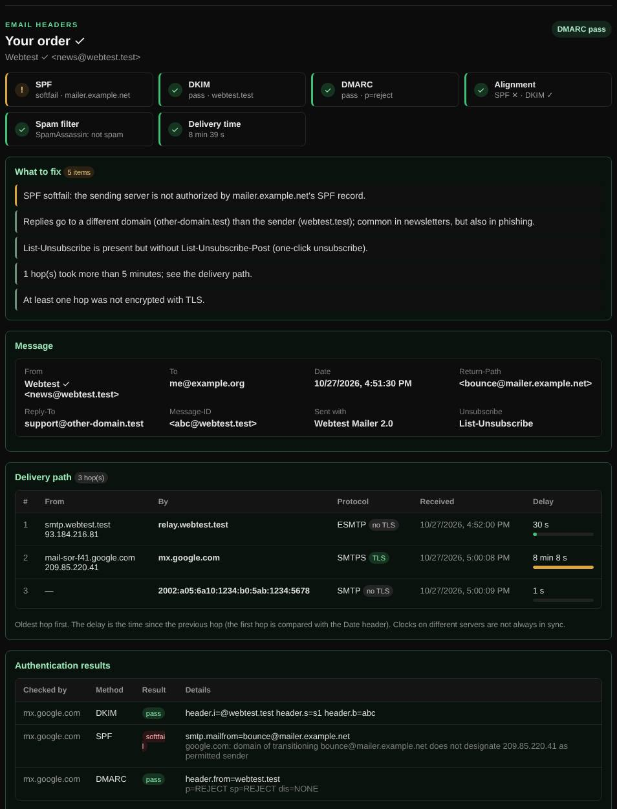

# Header analyzer

Explains how a received email was delivered, whether it passed SPF, DKIM and DMARC, and why a spam filter may have flagged it.

| | |
| --- | --- |
| **Where** | **Email** tab → **Header analyzer** |
| **Default access** | Logged-in users |

## What it does

Every email carries headers that record its route and the checks receiving
servers ran. The analyzer turns that wall of text into a readable report.

## How to get the headers

| Client | Where |
| --- | --- |
| Gmail | ⋮ → **Show original** |
| Outlook | **File → Properties → Internet headers** |
| Apple Mail | **View → Message → All Headers** |

## What it checks

| Section | Details |
| --- | --- |
| Delivery path | Every `Received` hop, oldest first, with the delay since the previous hop, TLS use, and the sender's reverse DNS and location |
| Authentication | SPF, DKIM, DMARC, ARC and compauth results from `Authentication-Results` |
| Alignment | Whether SPF (envelope domain) and DKIM (`d=`) match the From domain, as DMARC requires |
| DKIM signatures | Domain, selector, algorithm and number of signed headers |
| Spam filters | SpamAssassin, Rspamd and Microsoft 365 (SCL, BCL) verdicts and scores |
| Other | Reply-To on another domain, List-Unsubscribe and one-click unsubscribe, slow hops, hops without TLS |

## Good to know

- Up to 256 KB of headers. The message body is ignored.
- Headers are analyzed on the server and not stored, unless you save the result
  to history or share it.

---

[← Back to the wiki](README.md)
