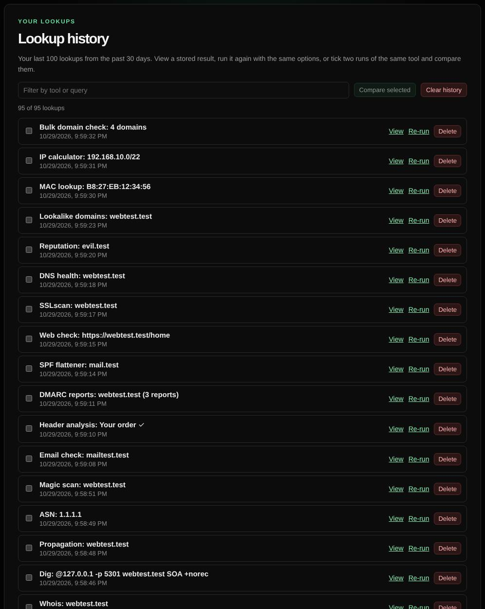

# History

Keeps your recent lookups so you can view them again, re-run them, or compare two runs.

| | |
| --- | --- |
| **Where** | **History** link in the header |
| **Default access** | Logged-in users |

## What it does

Every lookup you run while signed in is saved. The History page lets you:

- **View** a stored result exactly as it was.
- **Re-run** it with the same options.
- **Compare** two runs of the same tool: tick both and click *Compare selected*.
  Differences are listed field by field; timing fields and answer order are ignored.

## Limits

- Your last 100 lookups from the past 30 days. Results over 512 KB are kept for
  re-running only.
- History is private to you and is deleted with your account.

---

[← Back to the wiki](README.md)
