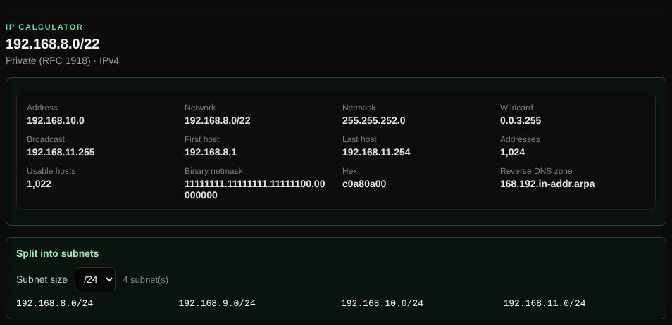

# IP calculator

Works out the network, host range and size of an IPv4 or IPv6 prefix and splits it into subnets, right in your browser.

| | |
| --- | --- |
| **Where** | **IP calculator** tab |
| **Default access** | Logged-in users |

## What it does

The everyday subnet calculator: enter an address with a prefix or netmask and see
everything about the network.

## Input

| Example | Meaning |
| --- | --- |
| `192.168.10.77/22` | Address with prefix length |
| `10.1.2.3 255.255.252.0` | Address with netmask (a wildcard such as `0.0.3.255` also works) |
| `2001:db8:abcd::/48` | IPv6 prefix |

## What it shows

| IPv4 | IPv6 |
| --- | --- |
| Network, broadcast, netmask, wildcard | Network, first and last address |
| First and last host, number of addresses and usable hosts | Number of addresses, expanded notation |
| Binary netmask, hex, address type (private, CGNAT, public, …) | Address type (global unicast, ULA, link-local, …) |
| Reverse DNS zone | Reverse DNS zone (`ip6.arpa`) |

Choose a subnet size to split the network; the first 256 subnets are listed.

## Good to know

Everything is calculated in your browser; nothing is sent to the server.

---

[← Back to the wiki](README.md)
