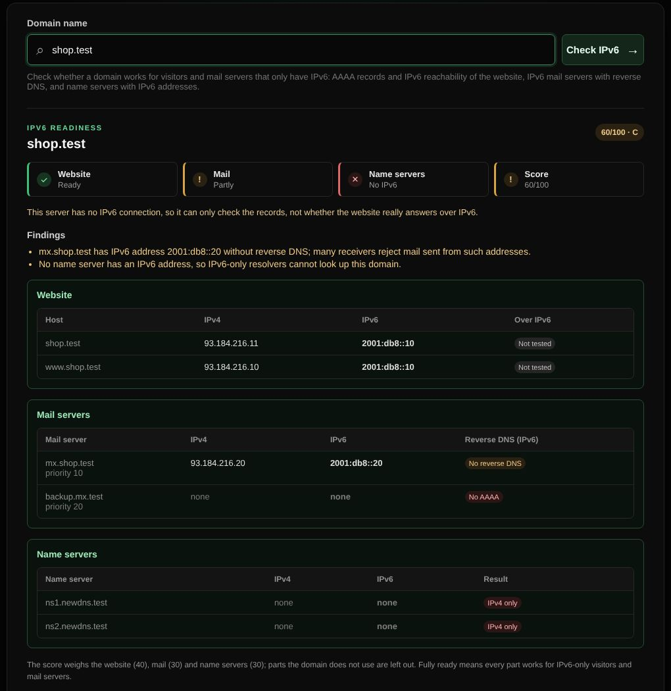

# IPv6 readiness

Checks whether a domain works for visitors and mail servers that only have IPv6.

| | |
| --- | --- |
| **Where** | IPv6 tab |
| **Default access** | Logged-in users |

## What it checks

| Part | Points | Ready when |
| --- | --- | --- |
| Website | 40 | The domain and `www` have AAAA records, and the site answers over IPv6 |
| Mail | 30 | The mail servers have AAAA records with reverse DNS (receivers reject IPv6 mail from addresses without it) |
| Name servers | 30 | Every name server has an IPv6 address |

Parts the domain does not use (for example no website, or a domain that does not
receive mail) are left out of the score.

## How it works

Records are looked up over DNS over HTTPS. To test whether the website really
answers over IPv6, BNGlookup itself needs an IPv6 connection; it tests this once
every ten minutes. Without it, only the records are checked and the result says
so (Docker networks often have no IPv6 unless it is enabled).

An AAAA record that does not answer is worse than none: browsers try IPv6 first
and fall back only after a delay. The check reports that as a problem.
