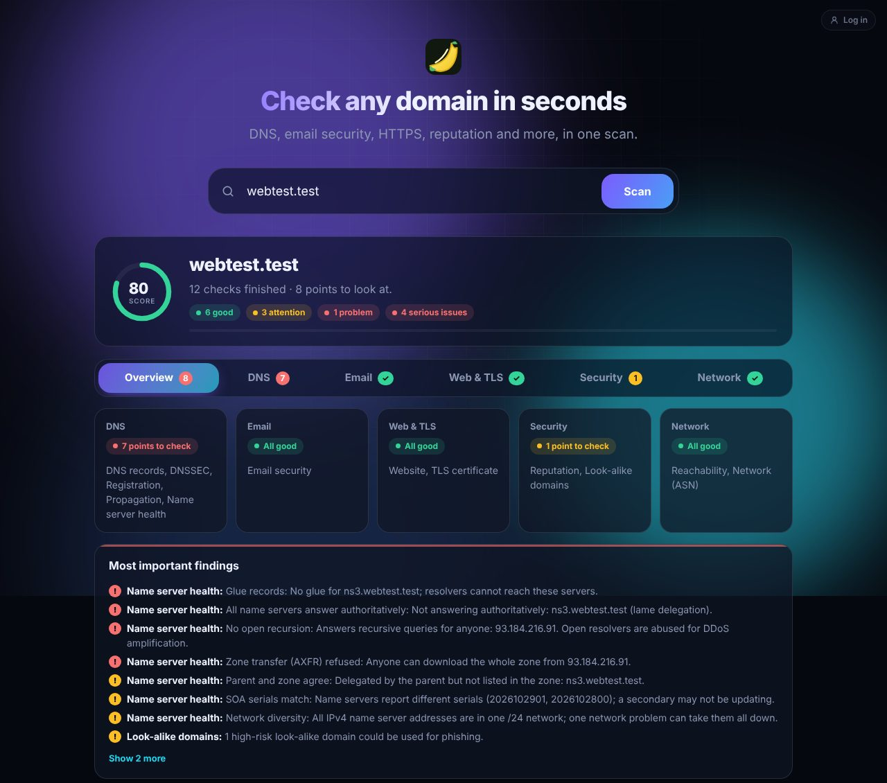
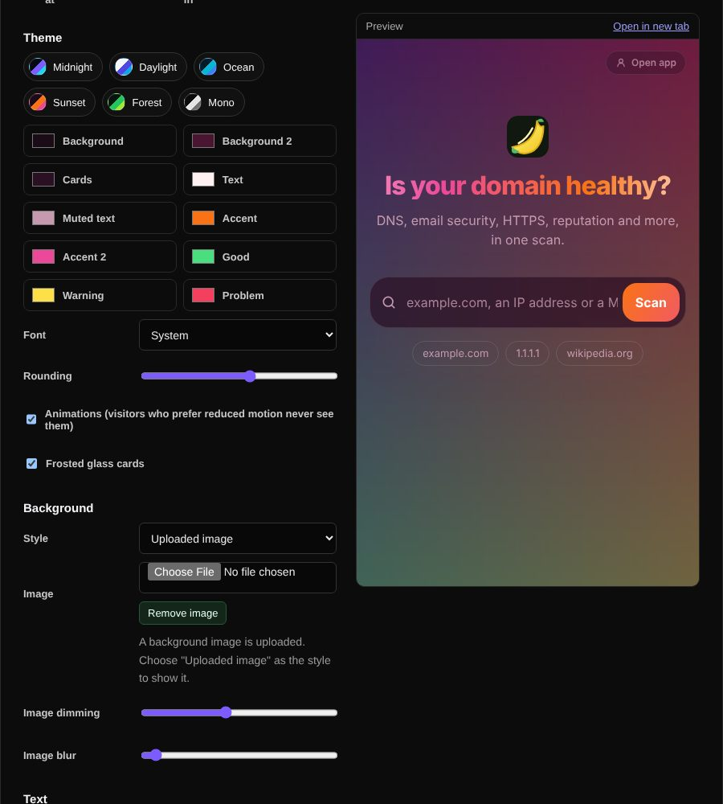

# Landing page

A simple start page for visitors who are not logged in: one search box that runs every public tool at once and shows the results in tabs per category.

| | |
| --- | --- |
| **Where** | `/` for visitors who are not logged in (always at `/landing`) |
| **Settings** | Admin → Settings → Landing page |

## What it does

Type a domain, URL, e-mail address, IP address or MAC address and press *Scan*.
The page recognizes the input and runs every tool that fits and that is set to
**Public** under Admin → Access & network. Results appear as they come in:

| Tab | Checks (when public) |
| --- | --- |
| Overview | Score, counts and the most important findings from all tabs |
| DNS | DNS records (A, AAAA, MX, NS, TXT, CAA), DNSSEC, registration, propagation, name server health |
| Email | MX, SPF, DMARC, DKIM, MTA-STS, TLS-RPT, BIMI and STARTTLS |
| Web & TLS | Web check grade and headers, TLS certificate |
| Security | Reputation, look-alike domains |
| Network | Reachability, ASN and RPKI; MAC vendor for MAC addresses |

For an IP address it runs reverse DNS, IP registration, reputation, reachability
and ASN. Tabs without public tools are hidden. The score counts good results as
100, warnings as 60 and problems as 15, and leaves informational results out.

The small *Log in* button in the corner opens the login page. After logging in,
a *Simple / Full* switch at the top right moves between this page and the full
interface with all tabs. The choice is remembered in the browser; until a user
picks one, they start in the interface the administrator chose. Links into the
full interface (`/?mode=…`, share links) keep working for everyone.

## Limits

One scan counts as **one** public lookup of the daily limit (15 per IP address),
however many tools it runs. Starting a scan gives the browser a short-lived token
(5 minutes, bound to the visitor's IP address, at most 8 calls per tool and 30 in
total). Calls beyond that count as normal public lookups.

## Customizing

**Admin → Settings → Landing page** shows a live preview of every change; nothing
goes live until you click *Save landing page*.

| Setting | Options |
| --- | --- |
| Show at `/` | Turn off to show the full interface (with its login prompt) at `/` again to visitors who are not logged in |
| Logged-in users | Start in the full or the simple interface (users can switch at any time) |
| Theme presets | Midnight, Daylight, Ocean, Sunset, Forest, Mono |
| Colors | Background, second background, cards, text, muted text, two accents, good, warning and problem |
| Font and rounding | System, rounded, serif, mono or geometric; corner rounding 0–32 px |
| Animations | Aurora blobs, shining title, sliding tabs, staggered cards and count-ups; visitors who prefer reduced motion never see them |
| Frosted glass | Blurred, translucent cards |
| Background | Animated aurora, moving gradient, solid color or an uploaded image (PNG, JPEG, WebP or GIF up to 5 MB) with dimming and blur |
| Text | Headline, subheading, search hint, button labels, example searches, the message shown when no tools are public, footer and every tab name |

*Reset theme and text* fills in the defaults (save to apply). Uploading or
removing a background image takes effect immediately.
