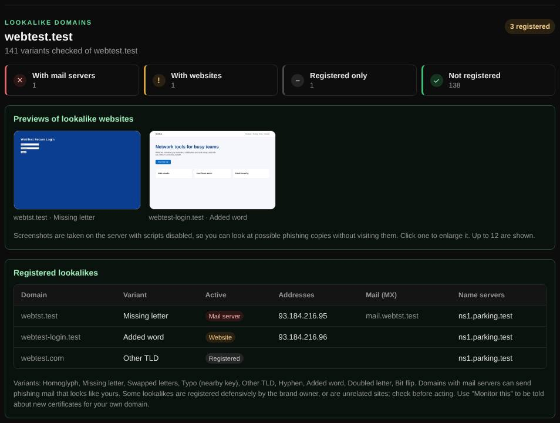

# Lookalike domains

Finds registered domains that look like yours, such as typos and look-alike characters, which are often used for phishing.

| | |
| --- | --- |
| **Where** | **Security** tab → **Lookalike domains** |
| **Default access** | Logged-in users |

## What it does

Attackers register `examp1e.com` or `example-login.com` to fool your customers
and staff. This tool generates likely variants of your domain and shows which
ones exist, with their web and mail servers and a preview of each website.

## How it works

1. Up to 260 variants of the registrable domain are generated.
2. Each is checked through DNS: an NS answer means it is registered; A and MX
   records show whether it has a website or mail server.
3. Registered variants are listed, those with mail servers first.

| Variant type | Example for `example.com` |
| --- | --- |
| Look-alike characters | `examp1e.com`, `exarnple.com` (`rn` for `m`), `ex4mple.com` |
| Missing, doubled or swapped letters | `exmple.com`, `exxample.com`, `examlpe.com` |
| Nearby keys | `exsmple.com` |
| Hyphens and added words | `exam-ple.com`, `example-login.com`, `secure-example.com` |
| Bit flips | `exampld.com` |
| Other TLDs | `example.net`, `example.co`, `example.shop` |

## Results

| Label | Meaning |
| --- | --- |
| **Mail server** | Has MX records and can send or receive phishing mail |
| **Website** | Has an address; see its preview |
| **Registered** | Exists, but has no web or mail server yet |

## Good to know

- Some lookalikes are registered by the brand owner for protection, or are
  unrelated businesses; check before acting.
- *Monitor this* sets up a Certificate Transparency [monitor](monitors.md) for
  your own domain, to catch new certificates for your name.

---

[← Back to the wiki](README.md)
