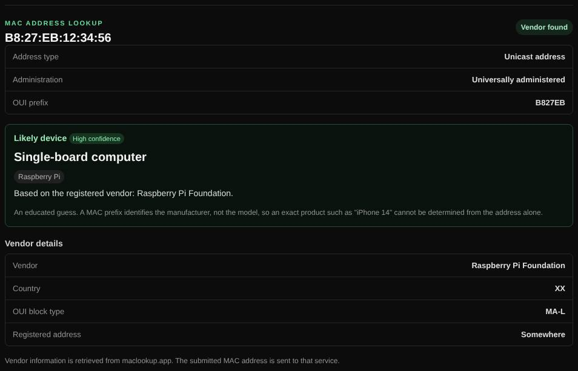

# MAC lookup

Identifies the manufacturer behind a MAC address and guesses what kind of device it is.

| | |
| --- | --- |
| **Where** | **MAC lookup** tab; also through [Auto lookup](auto-lookup.md) |
| **Default access** | Logged-in users |

## What it does

The first half of a MAC address (the OUI) identifies the manufacturer. The result
shows the vendor, the size of its address block and the address type, plus a
**likely device** guess with a confidence level.

## How it works

1. The vendor is looked up at `maclookup.app`.
2. The address type is read from its bits: unicast or multicast, globally unique
   or locally administered (randomized "private" addresses, as used by phones).
3. Known vendors and prefixes map to device types, for example Raspberry Pi,
   Espressif (IoT), Sonos, Ubiquiti, printers, NAS, virtual machines and containers.

## Good to know

A MAC prefix identifies the manufacturer, not the model; an exact product (such
as a specific phone) cannot be determined. Randomized addresses have no vendor.

---

[← Back to the wiki](README.md)
