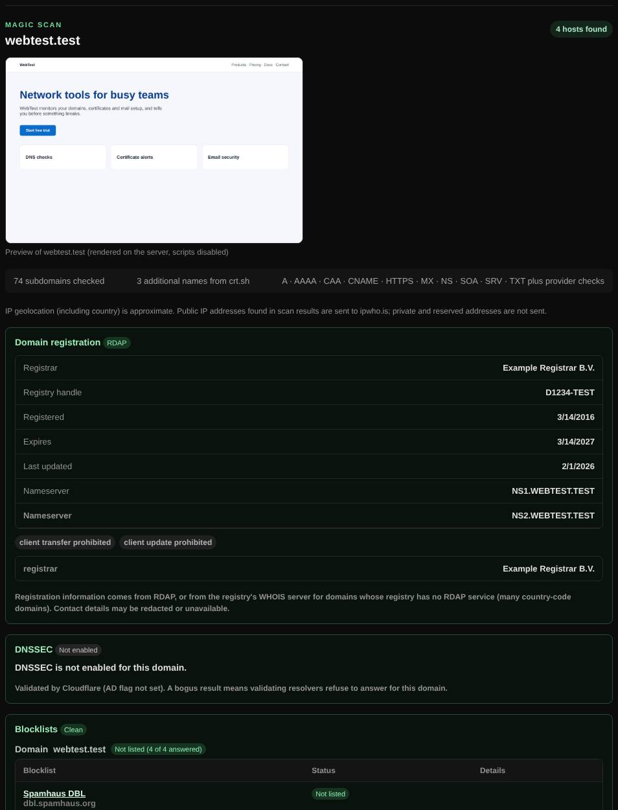

# Magic scan

A one-click overview of a whole domain: DNS records, subdomains, registration, DNSSEC, mail security, blocklists, takeover risks and a preview of the website.

| | |
| --- | --- |
| **Where** | **Magic scan** tab |
| **Default access** | Administrators |

## What it does

Magic scan collects in one report what you would otherwise check with a dozen
tools. Use it to get to know a domain, audit your own, or prepare a migration.

## How it works

1. A, AAAA, CAA, CNAME, HTTPS, MX, NS, SOA, SRV and TXT are queried for the domain,
   a list of common subdomains (`www`, `mail`, `api`, `staging`, …) and cloud
   provider verification names (AWS/SES, Azure, Google Cloud, Cloudflare,
   Vercel, Netlify, Heroku, DigitalOcean, …).
2. Up to 25 extra subdomains are taken from Certificate Transparency logs
   (`crt.sh`, falling back to CertSpotter).
3. The results are combined with RDAP registration, DNSSEC, mail security,
   blocklists, takeover detection, reverse DNS and geolocation.

## What it checks

| Section | Details |
| --- | --- |
| Hosts and records | Every host found, with its records and providers |
| Registration | Registrar, dates and name servers |
| [DNSSEC](dnssec.md) | Signed, chain of trust, validation |
| [Blocklists](blocklists.md) | The domain and its addresses on spam lists |
| [Subdomain takeover](subdomain-takeover.md) | CNAMEs to deleted or unclaimed services |
| Email authentication | SPF (with lookup count), common DKIM selectors, DMARC, MTA-STS, TLS-RPT |
| [Website preview](website-previews.md) | Screenshot of the homepage |

## Optional additions

Tick these before scanning; they run afterwards and are saved with the result:

- **Email check**, **SSLscan** (with the optional TLS grade), **Web check** and **DNS health**.
- **Port check** of 26 common TCP ports on up to 8 addresses (asks for
  confirmation; only scan systems you are authorized to test).

## Good to know

Results are not exhaustive: custom DKIM selectors and unlisted subdomains are not found.

---

[← Back to the wiki](README.md)
