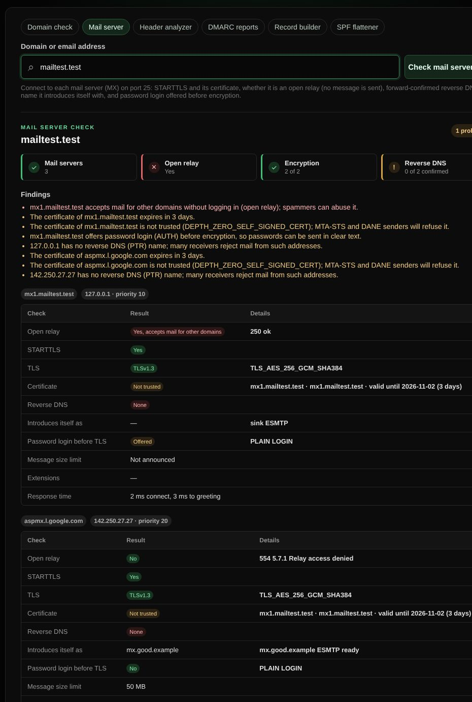

# Mail server check

Connects to a domain's mail servers on port 25 and tests what other mail servers see: encryption, open relaying, reverse DNS and how the server introduces itself.

| | |
| --- | --- |
| **Where** | Email → Mail server |
| **Default access** | Logged-in users |

## What it does

Enter a domain or an email address. The tool looks up the MX records and connects
to the first three mail servers that have a public IPv4 address. For each server
it shows:

| Check | What it means |
| --- | --- |
| Open relay | Whether the server accepts mail from a foreign sender for a foreign recipient. An open relay is abused by spammers and gets blocklisted. |
| STARTTLS and TLS | Whether mail can be encrypted, the TLS version and cipher. |
| Certificate | Trusted, matching the host name, and valid for long enough. MTA-STS and DANE senders refuse untrusted certificates. |
| Reverse DNS | The address's PTR name, and whether that name points back to the address (forward-confirmed). Many receivers reject mail from servers without it. |
| Introduces itself as | The host name in the greeting, compared with the MX name and the reverse DNS name. |
| Password login before TLS | Servers should only offer AUTH after STARTTLS, or passwords can travel unencrypted. |
| Size limit, extensions, response time | Announced message size limit, PIPELINING, SMTPUTF8, REQUIRETLS and similar, and how fast the server answers. |

## How it works

1. MX records are resolved over DNS over HTTPS; private and reserved addresses are
   not tested unless your role allows local targets.
2. The tool connects, sends `EHLO`, upgrades with `STARTTLS` when offered and
   sends `EHLO` again.
3. For the relay test it sends `MAIL FROM:<…@example.org>` and
   `RCPT TO:<…@example.com>`. A server that accepts the recipient is an open
   relay. The session then ends with `RSET` and `QUIT`: **no message is sent**.
4. The PTR name of each address is looked up and resolved back.

Many hosting providers block outbound port 25. When every server is unreachable,
the result says the check could not run from this server.

On the landing page the check appears in the Email tab when it is public, with
fixes for open relays, login before TLS and reverse DNS.
