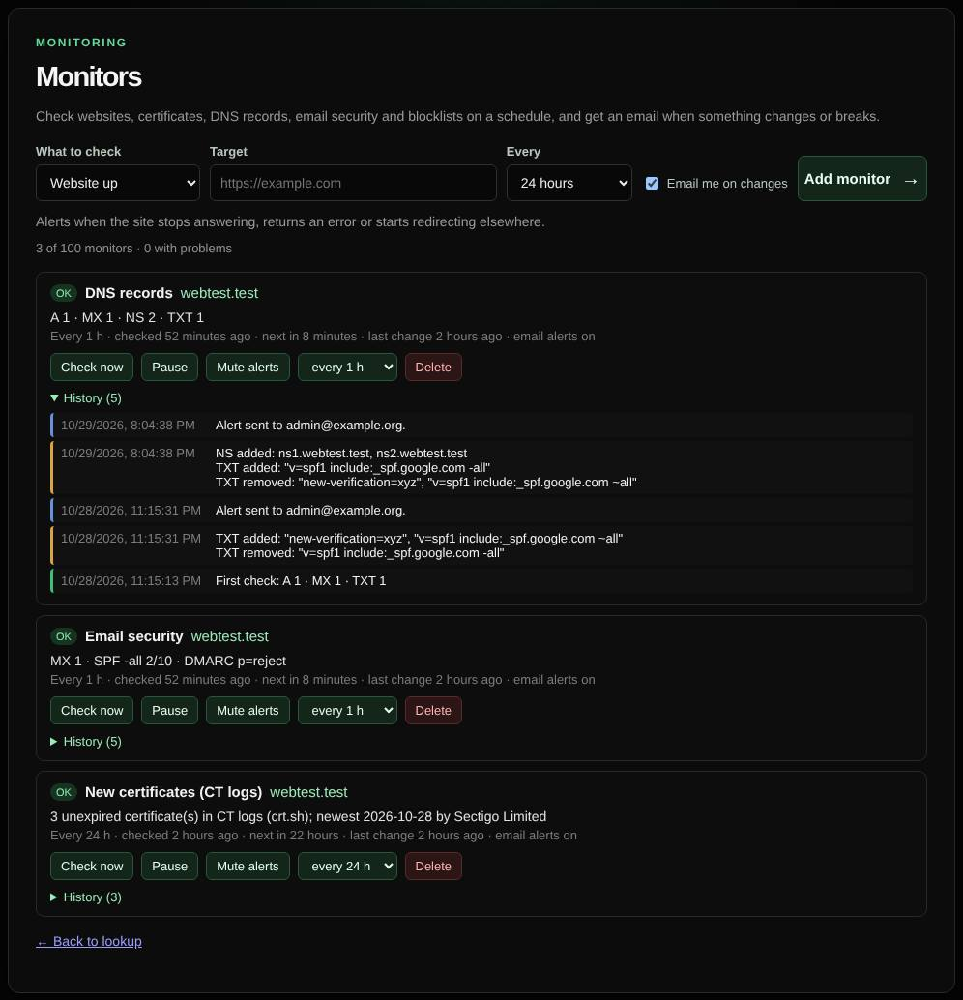
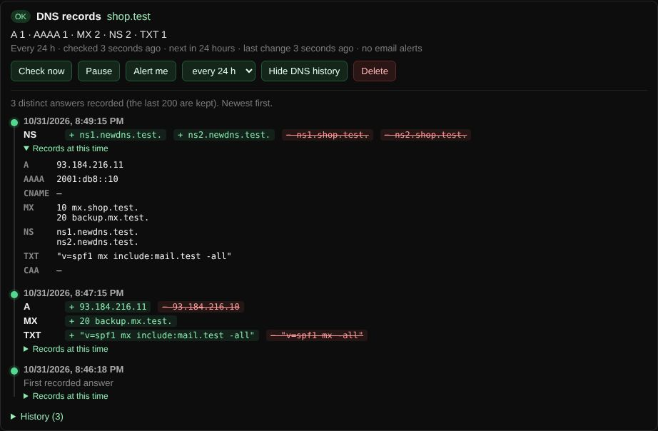

# Monitors

Checks websites, certificates, DNS, email security, blocklists and Certificate Transparency on a schedule, and emails you when something changes or breaks.

| | |
| --- | --- |
| **Where** | **Monitors** link in the header; **Monitor this** below results |
| **Default access** | Logged-in users (always requires a login) |

## What it does

Turns one-off lookups into continuous monitoring. Each monitor keeps a history of
its results, and changes are emailed to the address on your account.

## Monitor types

| Type | Target | Alerts when |
| --- | --- | --- |
| Website up | URL or domain | The site stops answering, returns an error or starts redirecting elsewhere |
| Certificate | Host, optionally `:port` | The certificate expires within 14 days, becomes untrusted or is replaced |
| DNS records | Domain | A, AAAA, CNAME, MX, NS, TXT or CAA records change |
| Email security | Domain | MX, SPF, DMARC or MTA-STS change, or SPF or DMARC break |
| Blocklists | Domain or public IPv4 | The domain or its address is listed or delisted |
| New certificates (CT logs) | Domain | A new certificate for the domain or a subdomain appears in Certificate Transparency logs, which can reveal phishing sites |

## DNS history

For **DNS records** monitors, **DNS history** shows every distinct answer the
monitor saw (the last 200), newest first: the records added (green) and removed
(red) per type, and the full set of records at each point in time. Unexpected
changes to NS or MX records can mean a hijacked domain.

## How it works

1. Add a monitor with its target and interval (every 1, 6, 12 or 24 hours). The
   first check runs immediately.
2. A scheduler runs due monitors in the background.
3. Each result is compared with the previous one. Status changes and changed
   values are added to the monitor's history and emailed to you.

Use **Check now**, **Pause**, **Mute alerts** or change the interval on each monitor.

## Limits

- 25 monitors per user, 100 for administrators.
- Alerts need an email address on **My account** and SMTP configured by an
  administrator; otherwise changes are only recorded on the page.

---

[← Back to the wiki](README.md)
