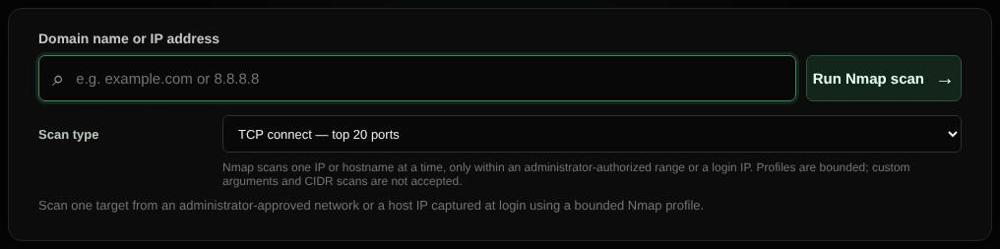

# Nmap

Runs a bounded Nmap scan of one approved host, with live progress.

| | |
| --- | --- |
| **Where** | **Nmap** tab |
| **Default access** | Administrators |

## What it does

Uses Nmap for a more thorough port scan, or light service detection, of a single
host you are authorized to assess.

## Profiles

| Profile | Scans |
| --- | --- |
| TCP connect, top 20 / 100 / 1000 | The most common TCP ports |
| Light service detection, top 20 | The top 20 ports, identifying the service behind each open port |

## Which targets are allowed

- Addresses in networks an administrator approved (**Admin → Port scans**), or
- the exact address you logged in from, added automatically for 30 days.

Targets are resolved by the server and must match the allowlist. Custom flags,
target lists and range scans are not accepted, and one scan runs at a time.
Only scan systems you own or are authorized to test.

---

[← Back to the wiki](README.md)
