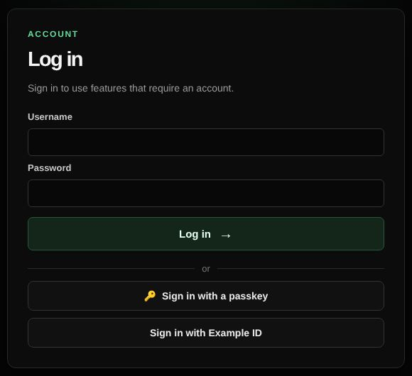
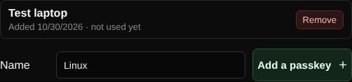
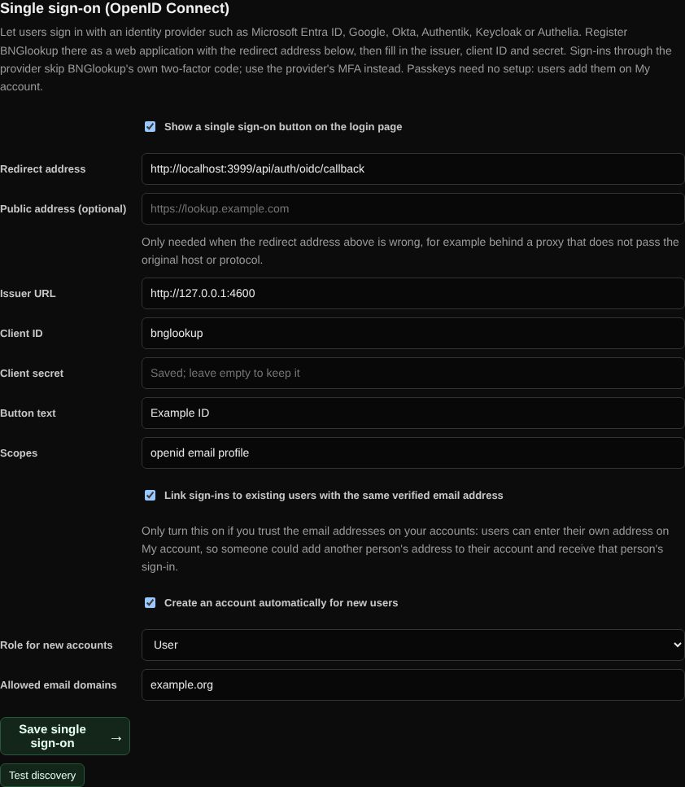

# Passkeys and single sign-on

Sign in without a password: with a passkey (fingerprint, face, device PIN or security key) or through your organization's identity provider.

| | |
| --- | --- |
| **Where** | Login page; passkeys on My account; Admin → Single sign-on |
| **Access** | All users; single sign-on is set up by an administrator |

## Passkeys

On **My account**, give the passkey a name and click **Add a passkey**; your
browser or phone asks for your fingerprint, face, PIN or security key. On the
login page, **Sign in with a passkey** signs you in without a username.

- Up to 10 passkeys per user. Remove one on My account.
- A passkey that checked your fingerprint, face or PIN replaces the two-factor
  code. A security key without a PIN still asks for the code.
- Passkeys need HTTPS (or `localhost`) and work only on the host name they were
  created on.
- The server checks every sign-in itself: the challenge, the site, user
  presence, the signature and the signature counter. A counter that goes
  backwards (a copied passkey) is refused.

## Single sign-on (OpenID Connect)

1. In your identity provider (Microsoft Entra ID, Google, Okta, Authentik,
   Keycloak, Authelia, …) create a web application. Use the **redirect address**
   shown in Admin → Single sign-on, for example
   `https://lookup.example.com/api/auth/oidc/callback`.
2. Enter the issuer URL, client ID and client secret, and click **Test discovery**.
3. Choose the button text, and whether to create accounts automatically (with
   allowed email domains and a role) and to link existing users by verified
   email address.
4. Turn it on and save. A **Sign in with …** button appears on the login page.

| Setting | Notes |
| --- | --- |
| Public address | Only needed when the redirect address is wrong, for example behind a proxy that hides the original host or protocol. |
| Link by email | Off by default. Users enter their own address on My account, so only turn this on when you trust those addresses. Never links when two accounts share an address. |
| Create accounts | New users get a user name from the provider (preferred user name or email) and cannot log in with a password. |

The sign-in uses the authorization code flow with PKCE. The ID token's
signature, issuer, audience, expiry and nonce are checked, and the callback must
come back to the same browser within 10 minutes. Sign-ins through the provider
skip BNGlookup's own two-factor code; use the provider's multi-factor login.
