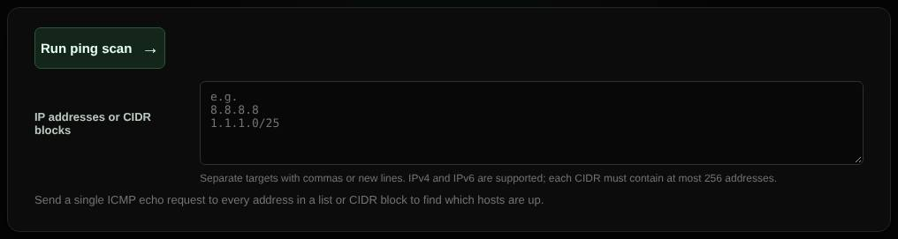

# Ping scan

Sends one ping to every address in a list or network to see which hosts are up.

| | |
| --- | --- |
| **Where** | **Ping scan** tab |
| **Default access** | Administrators |

## What it does

Quickly maps which addresses in a range respond, for example to find active
devices in a subnet.

## Input and limits

- Addresses and CIDR blocks separated by commas or new lines, IPv4 and IPv6,
  up to 256 addresses in total.
- One echo request per address. Hosts that block ICMP appear as down.
- Always requires a login; private ranges follow your role's local-network setting.

---

[← Back to the wiki](README.md)
