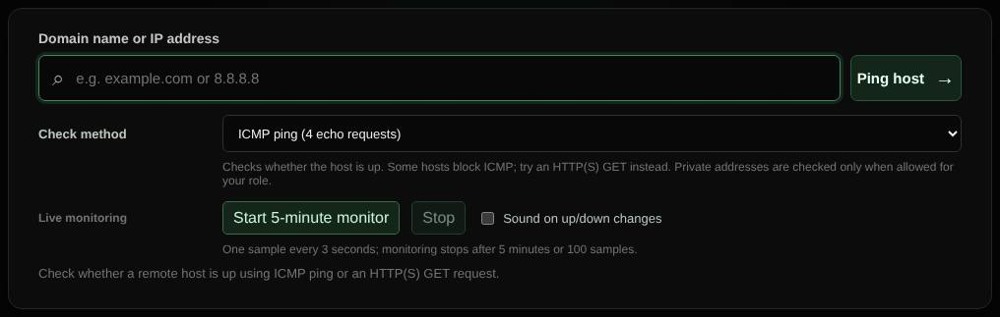

# Ping

Checks whether a host is up with ICMP ping or an HTTP(S) request, and can monitor it live for five minutes.

| | |
| --- | --- |
| **Where** | **Ping** tab |
| **Default access** | Logged-in users |

## What it does

Tells you whether a host answers and how fast. Many hosts block ICMP, so an
HTTP or HTTPS request can be used instead.

## Methods

| Method | What it does |
| --- | --- |
| ICMP ping | Four echo requests; shows packet loss and minimum, average and maximum round-trip time |
| HTTPS / HTTP GET | One request to `/`; shows the status code and response time (redirects are reported, not followed) |

## Live monitoring

Signed-in users can start a **5-minute monitor**: one sample every 3 seconds (up
to 100), with a latency chart, an up/down history and an optional sound when the
host changes state. It stops when you leave the page. For checks that run
longer, use [Monitors](monitors.md).

## Good to know

Private addresses are only checked if your role may reach local networks.

---

[← Back to the wiki](README.md)
