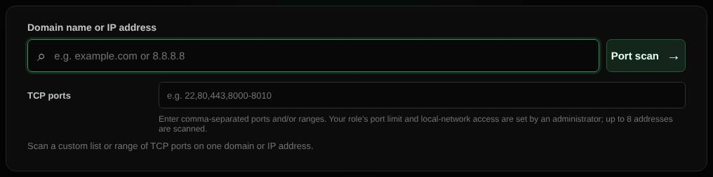

# Port scan

Checks which TCP ports accept connections on one host.

| | |
| --- | --- |
| **Where** | **Port scan** tab; a quick port check is also a [Magic scan](magic-scan.md) option |
| **Default access** | Administrators |

## What it does

Connects to each requested TCP port and reports which are open, for example to
verify a firewall or find services you did not expect.

## Input and limits

- One domain or IP address, and ports or ranges such as `22,80,443,8000-8010`.
- A domain is scanned on up to 8 of its addresses.
- The maximum number of ports is set per role (default: Admin 100, User 25).
- Always requires a login. Private targets follow the role setting (allowed for
  Admins by default, not for Users); other reserved addresses are always skipped.

## Good to know

A TCP connect scan shows that a port accepts connections; it does not identify
the service or test for vulnerabilities (see [Nmap](nmap.md)). Only scan systems
you are authorized to test.

---

[← Back to the wiki](README.md)
