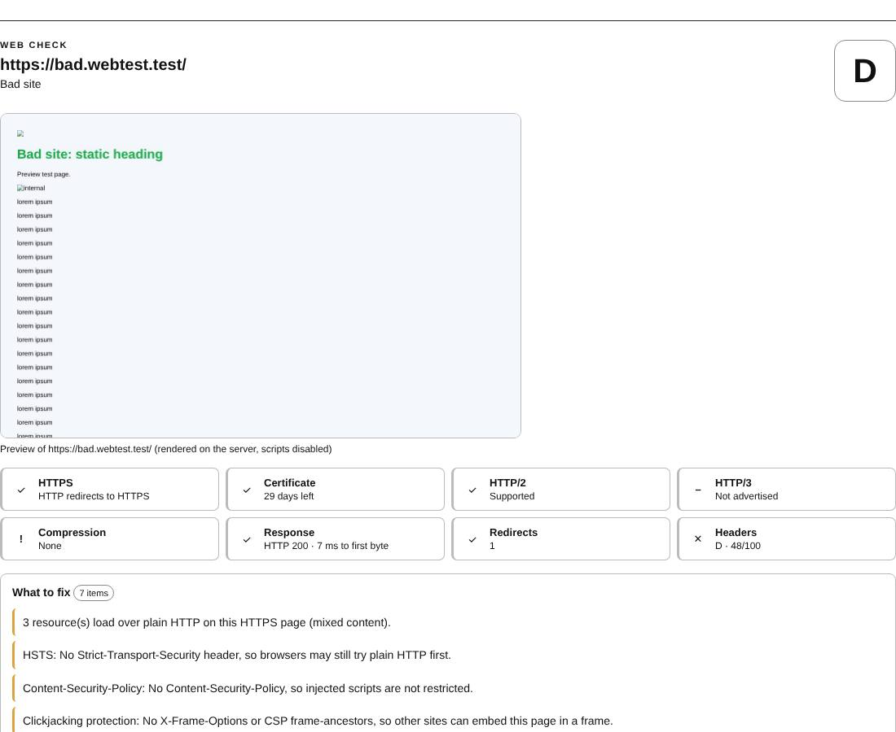

# Print and PDF

Prints a result, or saves it as a PDF, in a clean black-on-white layout.

| | |
| --- | --- |
| **Where** | **🖨 Print / save as PDF** below any result |
| **Default access** | Everyone who can see the result |

## How it works

1. Click **🖨 Print / save as PDF** below the result.
2. In the print dialog, choose a printer or **Save as PDF**.

The printout contains only the result: navigation and forms are hidden, colors
are converted for paper and collapsed sections (such as raw headers) are expanded.

---

[← Back to the wiki](README.md)
