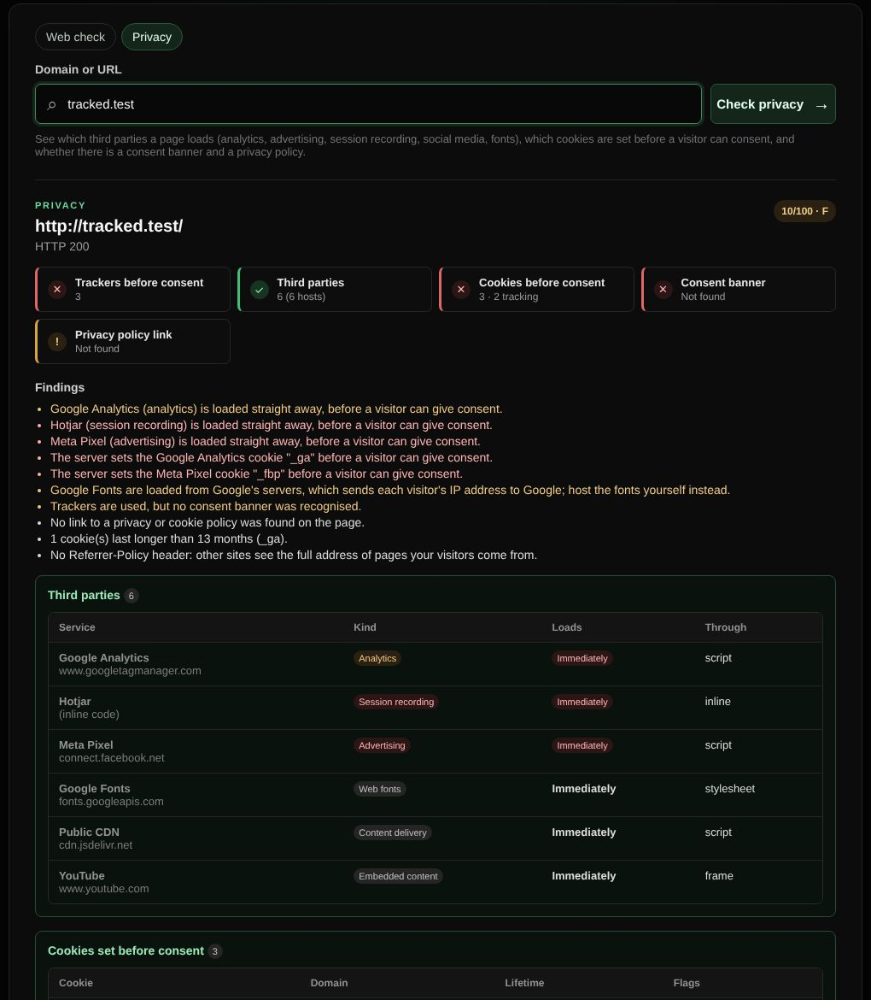

# Privacy check

Shows which third parties a page loads, which cookies are set before a visitor can consent, and whether there is a consent banner and a privacy policy.

| | |
| --- | --- |
| **Where** | Web check → Privacy |
| **Default access** | Logged-in users |

## What it does

| Part | What you see |
| --- | --- |
| Third parties | Every other domain the page loads scripts, styles, fonts, images or frames from, named when known (Google Analytics, Meta Pixel, Hotjar, LinkedIn, TikTok, Google Fonts, YouTube, …) and grouped by kind |
| Loads | *Immediately*, or *After consent* for scripts marked to wait (`type="text/plain"` with a consent attribute, as Cookiebot, Usercentrics and others use) |
| Cookies before consent | Every cookie the server sets when the page is opened, with known tracking cookies (`_ga`, `_fbp`, `_hjSession…`), lifetime and flags |
| Consent banner | Cookiebot, OneTrust, Usercentrics, Didomi, iubenda, CookieYes, Complianz and others |
| Other | A link to a privacy or cookie policy, Google Fonts loaded from Google (sends visitors' IP addresses to Google), YouTube embeds without `youtube-nocookie.com`, cookies that last longer than 13 months and the Referrer-Policy |

Trackers that load before consent, tracking cookies and missing banners lower the
score most.

## Limits

The page's HTML and the server's cookies are read as a first-time visitor who has
not consented; **scripts are not run**. Trackers that other scripts add later
(for example through Google Tag Manager) and cookies set by JavaScript are not
seen, so a page can track more than shown. This is a technical check, not legal
advice.
