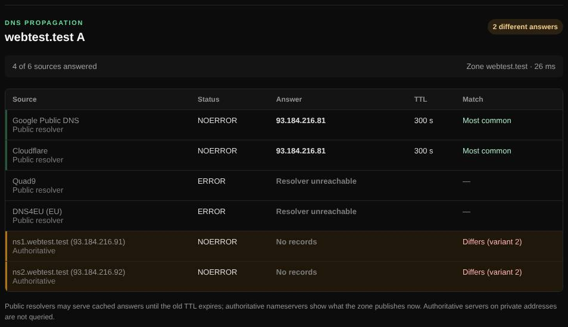

# Propagation

Shows whether a DNS change has reached the big public resolvers and the domain's own name servers.

| | |
| --- | --- |
| **Where** | **Propagation** tab |
| **Default access** | Logged-in users |

## What it does

After you change a DNS record, resolvers keep the old answer until its TTL runs
out. Propagation asks several resolvers at once so you can see who already has
the new value.

## How it works

1. The record is queried through each built-in resolver: Cloudflare, Google,
   Quad9 and DNS4EU (plus `DOH_ENDPOINT` if configured).
2. The zone's authoritative name servers are found by walking up the name, and
   asked directly; they always have the current value.
3. Identical answers are grouped, and resolvers that differ from the
   authoritative answer are highlighted.

## Good to know

- Differences usually disappear once the old record's TTL has passed.
- Authoritative servers on private addresses are not queried.

---

[← Back to the wiki](README.md)
