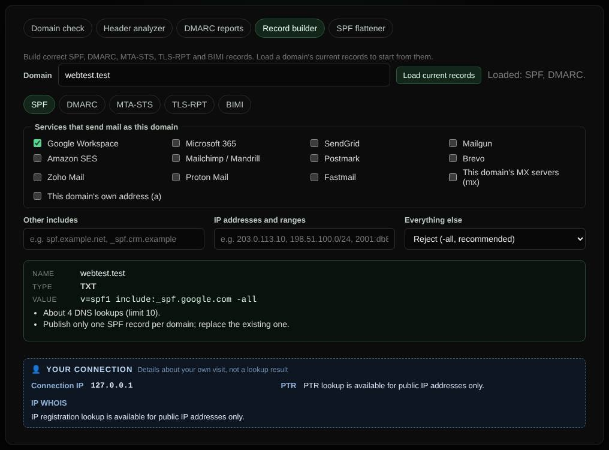

# Record builder

Builds correct SPF, DMARC, MTA-STS, TLS-RPT and BIMI records from simple forms, ready to copy into your DNS.

| | |
| --- | --- |
| **Where** | **Email** tab → **Record builder** |
| **Default access** | Logged-in users |

## What it does

Writing these records by hand is error-prone. The builder produces the record
name, type and value as you fill in the form, with notes about common mistakes.

## How it works

1. Enter the domain and click **Load current records** to start from what is
   published today.
2. Pick a tab and adjust the form; the record updates as you type.
3. Click the name or value to copy it into your DNS provider.

| Tab | Produces |
| --- | --- |
| SPF | `v=spf1` with checkboxes for common providers (Google Workspace, Microsoft 365, SendGrid, Mailgun, Amazon SES, …), extra includes and IP ranges, and a DNS lookup estimate |
| DMARC | `_dmarc` record with policy, subdomain policy, percentage, report addresses and alignment |
| MTA-STS | The `_mta-sts` TXT record and the policy file for `https://mta-sts.<domain>/.well-known/mta-sts.txt` |
| TLS-RPT | `_smtp._tls` record with the report address |
| BIMI | `default._bimi` record with the logo and optional mark certificate |

## Hosting the MTA-STS policy

Administrators can click **Host this policy on this server**. BNGlookup then
serves it at `/.well-known/mta-sts.txt`; point `mta-sts.<domain>` at the server
(with a valid certificate for that name) to publish it.

---

[← Back to the wiki](README.md)
