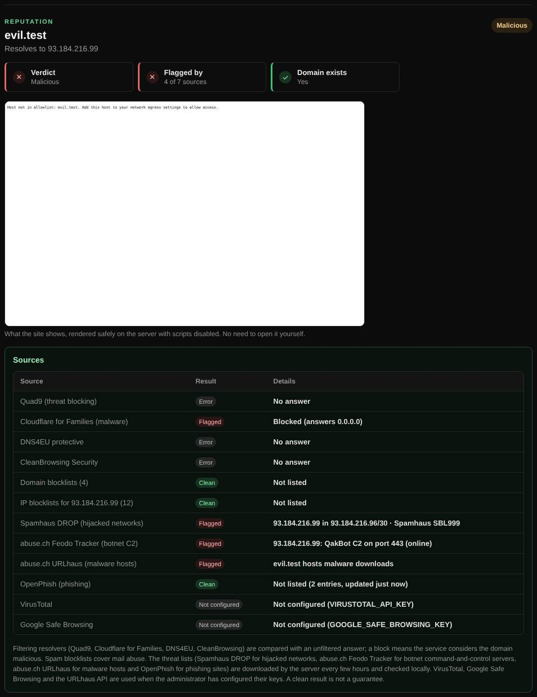

# Reputation

Asks several independent security services whether a domain, URL or IP address is known to be malicious.

| | |
| --- | --- |
| **Where** | **Security** tab → **Reputation** |
| **Default access** | Logged-in users |

## What it does

Combines protective DNS services, threat lists and spam blocklists into one
verdict: **No threats found**, **Suspicious** (one source) or **Malicious** (two or
more). A [preview](website-previews.md) shows what the site looks like, so you do
not have to visit it.

## How it works

| Source | How it is used |
| --- | --- |
| **Filtering resolvers**: Quad9, Cloudflare for Families, DNS4EU protective, CleanBrowsing Security | The domain is resolved through each and compared with an unfiltered answer. A block (NXDOMAIN, REFUSED or `0.0.0.0`) means the service considers it malicious. |
| **Spamhaus DROP** | The domain's addresses are matched against hijacked and criminal networks. |
| **abuse.ch Feodo Tracker** | The addresses are matched against botnet command-and-control servers. |
| **abuse.ch URLhaus** | The domain, its parent domains and addresses are matched against hosts serving malware. |
| **OpenPhish** | The domain and its parents are matched against active phishing sites. |
| **Spam blocklists** | As in [Blocklists](blocklists.md). |
| **VirusTotal, Google Safe Browsing, URLhaus API** | Only when the administrator has set their API keys. |

The threat lists are downloaded by the server on first use and refreshed every
six hours; lookups happen locally, so the queried name is not sent to them.

## Good to know

- A clean result is not a guarantee: new phishing sites are often not listed yet.
- For a domain that does not resolve, the filtering resolvers cannot give a verdict.
- Palo Alto URL categories (such as grayware) need a Palo Alto firewall or
  subscription and are not included.

---

[← Back to the wiki](README.md)
