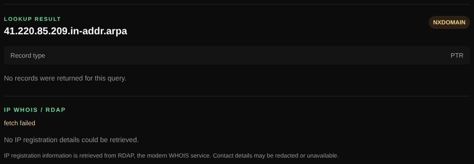

# Reverse lookup

Finds the host name (PTR record) for an IPv4 or IPv6 address and shows who the address is registered to.

| | |
| --- | --- |
| **Where** | **Reverse lookup** tab |
| **Default access** | Logged-in users |

## What it does

Every public IP address can have a reverse DNS name, such as
`mail-sor-f41.google.com`. Mail servers in particular need a correct PTR record.
The result also shows the address's registration: network range, owner and ASN.

## How it works

1. The address is converted to its reverse name (`41.220.85.209.in-addr.arpa`
   or the `ip6.arpa` form) and its PTR record is queried.
2. The registration is looked up through RDAP (`rdap.org`).

## Input and limits

- One IPv4 or IPv6 address. Administrators can query a specific name server.
- Private addresses usually have no public PTR record.

---

[← Back to the wiki](README.md)
