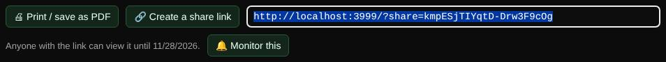

# Share links

Turns a result into a link that anyone can open for 30 days, without an account.

| | |
| --- | --- |
| **Where** | **Create a share link** below any result |
| **Default access** | Logged-in users |

## How it works

1. Run a lookup and click **🔗 Create a share link**.
2. Copy the link. Anyone who opens it sees the result as you saw it.
3. Manage and delete your links on **My account**. Administrators can delete any link.

## Good to know

- The result data is stored, not a screenshot, and shown through the same safe
  renderers as normal results.
- Links are hard to guess but not password-protected; only share what you are
  happy for the recipient to see.
- Up to 200 links per user and 1 MB per result.

---

[← Back to the wiki](README.md)
