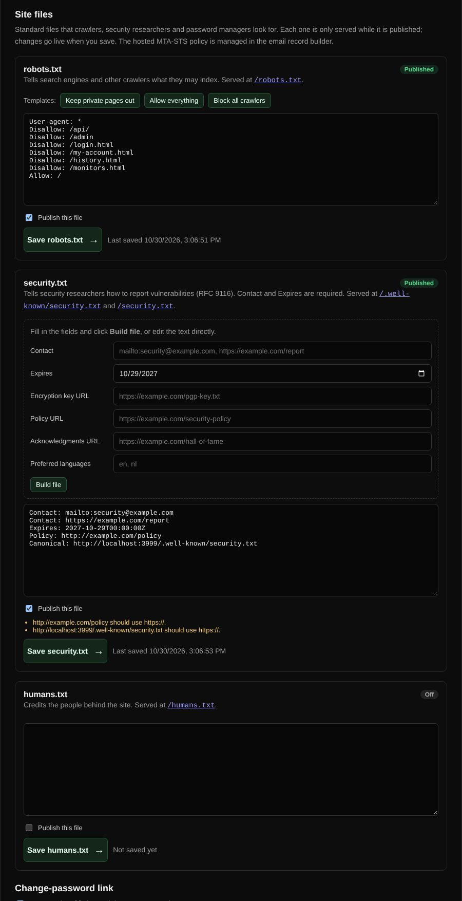

# Site files

Publishes robots.txt, security.txt and humans.txt for the BNGlookup site itself, plus the change-password link for password managers.

| | |
| --- | --- |
| **Where** | Admin → Settings → Site files |
| **Access** | Administrators |

## What it does

Every file has an editor, a *Publish this file* switch and a *Save* button. A file
is only served while it is published; otherwise the address returns 404.

| File | Served at | Purpose |
| --- | --- | --- |
| robots.txt | `/robots.txt` | Tells search engines and crawlers what they may index. |
| security.txt | `/.well-known/security.txt` and `/security.txt` | Tells security researchers how to report vulnerabilities ([RFC 9116](https://www.rfc-editor.org/rfc/rfc9116)). |
| humans.txt | `/humans.txt` | Credits the people behind the site. |
| Change-password link | `/.well-known/change-password` | Lets password managers open the account page to change a password. |

## robots.txt

Three templates fill the editor: *Keep private pages out* (blocks the API, admin,
login, account, history and monitor pages), *Allow everything* and *Block all
crawlers*. Lines that are not robots.txt rules are listed as warnings, and so is a
rule that blocks all crawlers from the whole site.

## security.txt

Fill in contacts, the expiry date and optional links (encryption key, policy,
acknowledgments, preferred languages) and click *Build file*. Plain email
addresses become `mailto:` contacts, and a `Canonical` line with this site's
address is added.

| Check | Effect |
| --- | --- |
| At least one Contact starting with `mailto:`, `https://` or `tel:` | Required to publish |
| Exactly one Expires date in the future, such as `2027-10-30T00:00:00Z` | Required to publish |
| Expires within 30 days | Warning |
| Expires more than a year ahead | Warning (RFC 9116 recommends less) |
| Links using `http://`, no Canonical line | Warning |

The files are plain text up to 16 KB and are served as `text/plain` with a
one-hour cache. [Web check](web-check.md) reads security.txt and robots.txt of
other sites the same way.
