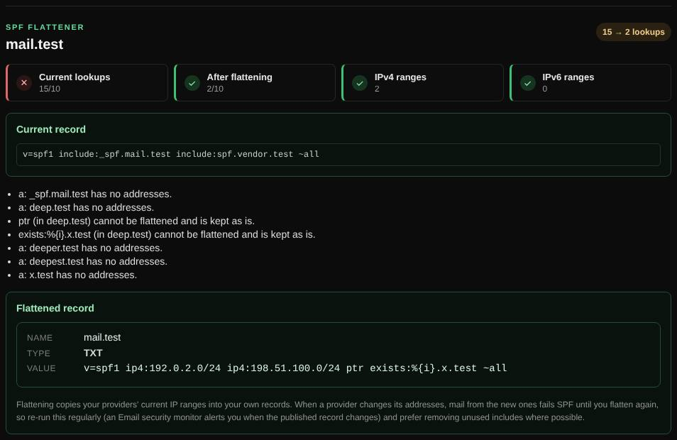

# SPF flattener

Rewrites an SPF record as plain IP ranges, to get under SPF's limit of 10 DNS lookups.

| | |
| --- | --- |
| **Where** | **Email** tab → **SPF flattener** |
| **Default access** | Logged-in users (same as the record builder) |

## What it does

Each `include`, `a` and `mx` in SPF costs a DNS lookup, and receivers treat more
than 10 as a permanent error, so SPF fails for all mail. Flattening replaces those
mechanisms with the IP ranges they currently resolve to.

## How it works

1. The domain's SPF record is resolved recursively: includes and redirects are
   followed, `a` and `mx` are turned into addresses.
2. All `ip4` and `ip6` ranges are collected, without duplicates.
3. If the result fits in 255 characters, one record is proposed; otherwise a
   main record with `include:_spf1.<domain>`, `_spf2.<domain>` … and the records
   for those names.

## Good to know

- `ptr` and `exists` cannot be flattened and are kept as they are.
- Flattened records do **not** follow your providers' changes. When a provider
  adds addresses, mail from them fails SPF until you flatten again. Re-run it
  regularly, or first remove includes you no longer use.

---

[← Back to the wiki](README.md)
