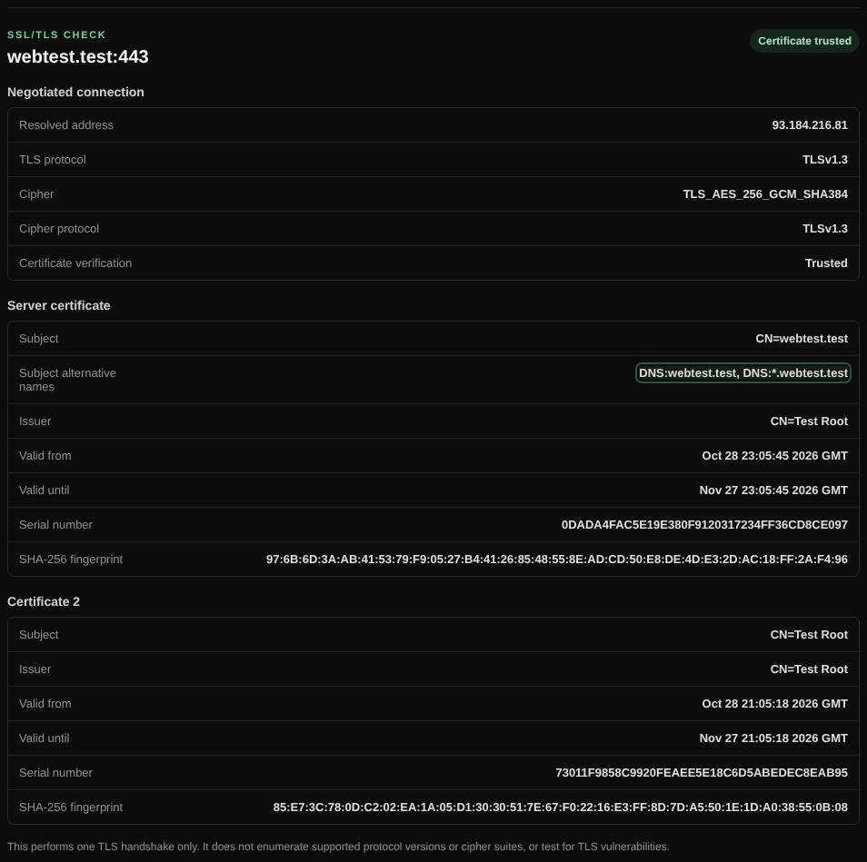

# SSLscan and TLS grade

Tests a server's TLS: the negotiated protocol and cipher, the certificate chain and, optionally, a full test graded like SSL Labs.

| | |
| --- | --- |
| **Where** | **SSLscan** tab; also a [Magic scan](magic-scan.md) option |
| **Default access** | Logged-in users |

## What it does

**SSLscan** makes one TLS connection and shows what was negotiated and which
certificates the server sent. The optional **full TLS test** checks every
protocol version, cipher suite and known vulnerability, and grades the server A+ to F.

## How it works

**Handshake check**

1. The host is resolved and one TLS handshake is made to the chosen port (default 443).
2. The protocol, cipher, certificate chain, validity dates and trust status are shown.

**Full TLS test** (signed-in users, about 1–3 minutes)

1. The bundled [testssl.sh](https://github.com/testssl/testssl.sh) runs inside the container.
2. It tests SSLv2 to TLS 1.3, every cipher suite, key exchange, the certificate and
   chain, HSTS, and vulnerabilities such as Heartbleed, ROBOT, POODLE, CCS
   injection, DROWN, Logjam and SWEET32.
3. The result is graded with the SSL Labs
   [SSL Server Rating Guide](https://github.com/ssllabs/research/wiki/SSL-Server-Rating-Guide):
   protocol 30 %, key exchange 30 %, cipher strength 40 %, plus caps such as
   **T** (untrusted certificate), **M** (name mismatch) and **F** (critical vulnerability).

## Good to know

- Works on any TLS port, for example 465 or 993 for mail.
- One full test per user and two per server at a time. No external service is used.
- Grades can differ slightly from SSL Labs, which tests every address of a host.

---

[← Back to the wiki](README.md)
