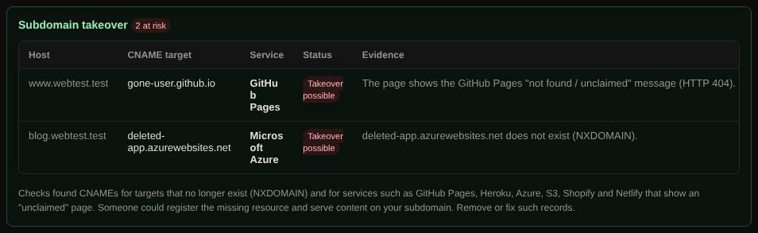

# Subdomain takeover

Finds subdomains that point to a deleted or unclaimed cloud resource, which someone else could claim and use to serve content on your domain.

| | |
| --- | --- |
| **Where** | Every [Magic scan](magic-scan.md) |
| **Default access** | Administrators (with Magic scan) |

## What it does

If `blog.example.com` is a CNAME to `example.github.io` and that GitHub Pages
site is deleted, anyone can create a new site with that name and publish content
on `blog.example.com`. This check finds such dangling records.

## How it works

1. The CNAME targets of hosts found by the scan are collected (up to 25).
2. Each target is resolved. **NXDOMAIN** (the target no longer exists) marks a
   dangling CNAME.
3. Targets on known services are fetched over HTTPS (then HTTP), and the page is
   compared with the service's "not found / unclaimed" text.

## Results

| Status | Meaning |
| --- | --- |
| **Takeover possible** | The CNAME points to a known service, and the target is missing or shows the unclaimed page. |
| **Dangling CNAME** | The target does not exist, but it is not a known takeover-prone service. |

Services recognized include GitHub Pages, Heroku, Amazon S3, Microsoft Azure,
AWS Elastic Beanstalk, Shopify, Fastly, Netlify, Zendesk, Ghost, Surge,
Bitbucket, Pantheon, Tumblr, WordPress.com, Webflow, Fly.io and Vercel.

## What to do

Remove the CNAME, or re-create the resource on the service. Findings also appear
on the admin [dashboard](dashboard.md).

---

[← Back to the wiki](README.md)
