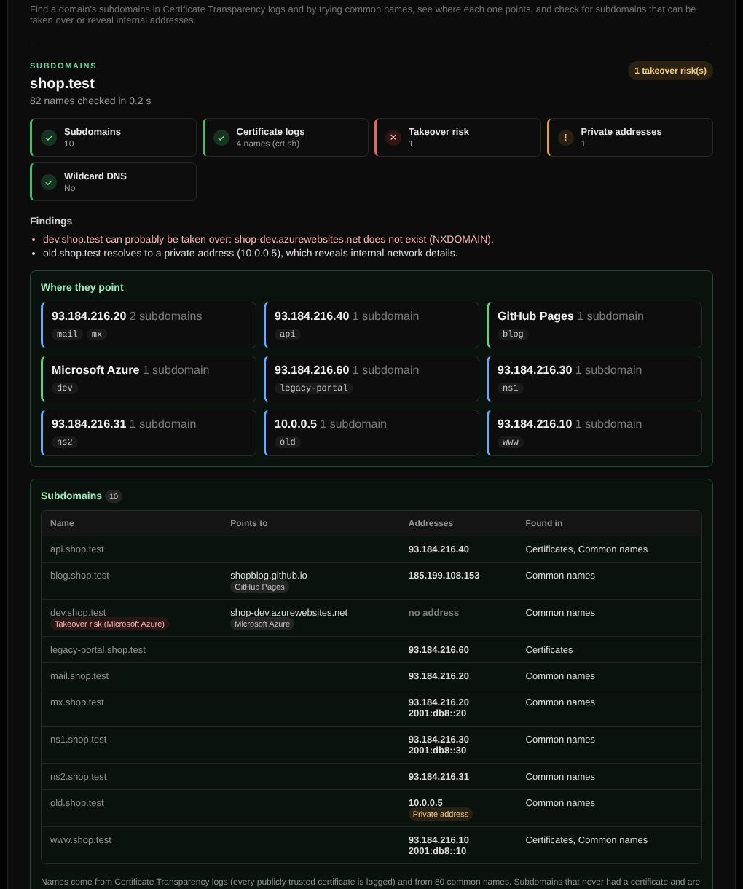

# Subdomain discovery

Finds a domain's subdomains, shows where each one points, and flags subdomains that can be taken over or reveal internal addresses.

| | |
| --- | --- |
| **Where** | Security → Subdomains |
| **Default access** | Logged-in users |

## What it does

| Part | What you see |
| --- | --- |
| Subdomains | Every subdomain found, what it points to (CNAME and addresses) and where it was found |
| Where they point | A map that groups subdomains by hosting provider (recognised from the CNAME: AWS, Azure, GitHub Pages, Netlify, Vercel, Heroku, Shopify, …) or by address |
| Takeover risk | Subdomains whose CNAME points to an unclaimed cloud resource or to a name that no longer exists |
| Private addresses | Subdomains that resolve to internal addresses such as 10.x or 192.168.x, which reveal details of your network |

## How it works

1. **Certificate Transparency logs** are searched (crt.sh, or CertSpotter when
   crt.sh does not answer). Every publicly trusted certificate is logged, so
   names on certificates are found even when nobody would guess them.
2. **80 common names** (`www`, `mail`, `vpn`, `dev`, `staging`, `api`, …) are tried.
3. A random name is resolved first to detect **wildcard DNS**; guessed names that
   only match the wildcard are left out.
4. Each name is resolved (A, AAAA and the CNAME chain), and names with a CNAME go
   through the [subdomain takeover](subdomain-takeover.md) check.

Subdomains that never had a public certificate and are not common names cannot
be found this way. On the [landing page](landing-page.md) the check appears in the
Security tab when it is public.
