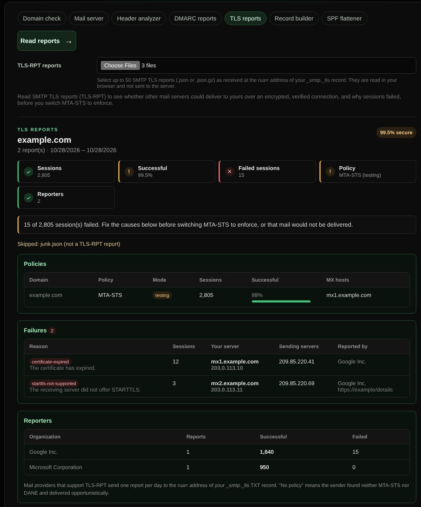

# TLS reports

Reads SMTP TLS reports (TLS-RPT) to show whether other mail servers could deliver to yours over an encrypted, verified connection, and why sessions failed.

| | |
| --- | --- |
| **Where** | Email → TLS reports |
| **Default access** | Logged-in users |

## What it does

Mail providers that support TLS-RPT (RFC 8460), such as Google and Microsoft,
send one report per day to the `rua=` address of your `_smtp._tls` TXT record.
Select up to 50 of them (`.json`, `.json.gz` or a `.zip`). The result shows:

- how many sessions were encrypted and verified, and how many failed;
- the policy per domain (MTA-STS or DANE) and its mode (`testing` or `enforce`);
- every failure, grouped by reason and receiving server, with the sending servers,
  the reporter and a plain explanation of the result type
  (`certificate-expired`, `starttls-not-supported`, `sts-policy-fetch-error`, …);
- the reporting organizations.

It says you can move MTA-STS from `testing` to `enforce` only when no session
failed; otherwise it lists what to fix first.

## How it works

The files are unpacked and read in your browser and are never sent to the
server. Create the `_smtp._tls` record with the [Record builder](record-builder.md).
