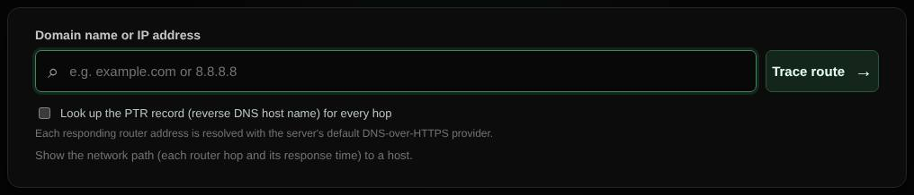

# Traceroute

Shows the network path to a host, router by router, with response times and optional reverse DNS for every hop.

| | |
| --- | --- |
| **Where** | **Traceroute** tab; **Multi traceroute** tab for several hosts |
| **Default access** | Logged-in users (Multi traceroute: Administrators) |

## What it does

Helps find where along the route a connection becomes slow or stops. **Multi
traceroute** traces up to 10 hosts and compares the paths side by side.

## How it works

1. `tracepath` sends UDP probes with increasing TTL; each router on the way
   answers when the TTL runs out.
2. Hops appear live as they answer, up to 20 hops or 45 seconds.
3. With **Look up the PTR record for every hop**, each router's host name is added.

## Good to know

- Routers that do not answer are shown as *no reply*; this is normal and does not
  mean the path is broken.
- Multi traceroute runs four traces at a time and always requires a login.

---

[← Back to the wiki](README.md)
