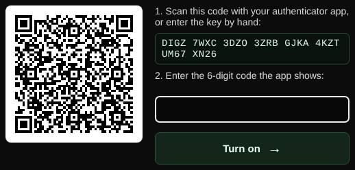

# Two-factor login

Protects your account with a code from an authenticator app in addition to your password.

| | |
| --- | --- |
| **Where** | **My account** → **Two-factor login** |
| **Default access** | Every account |

## Set it up

1. Open **My account**, confirm your password and click **Set up two-factor login**.
2. Scan the QR code with an authenticator app (Google Authenticator, Microsoft
   Authenticator, 1Password, Aegis, …), or type the key shown below it.
3. Enter the 6-digit code from the app and click **Turn on**.
4. **Save the ten recovery codes.** Each one signs you in once if you lose your phone.

## Signing in

After your password, enter the current 6-digit code, or one of your recovery codes.

## Good to know

- Codes change every 30 seconds; the current code and one step either side are
  accepted, and a code cannot be used twice.
- To turn it off or create new recovery codes, you need your password and a code.
- Lost your phone and your recovery codes? An administrator can reset two-factor
  login for you under **Admin → Users**.

---

[← Back to the wiki](README.md)
