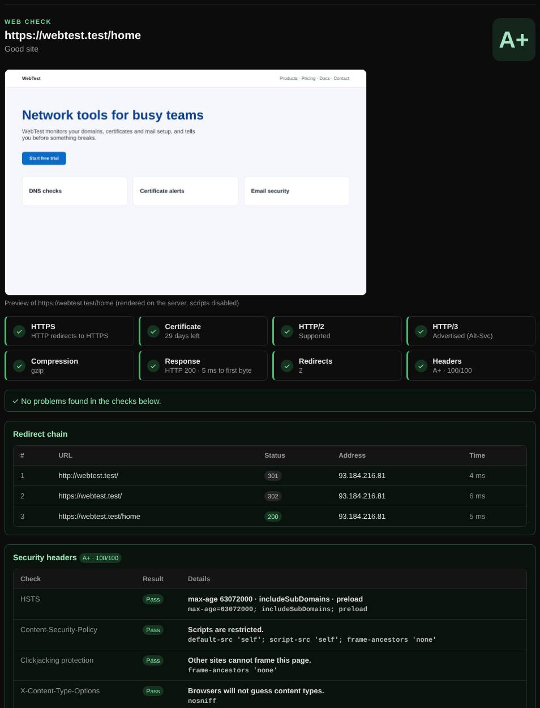

# Web check

Checks a website's HTTPS setup and security headers, follows its redirects, and grades it A+ to F.

| | |
| --- | --- |
| **Where** | **Web check** tab; also a [Magic scan](magic-scan.md) option |
| **Default access** | Logged-in users |

## What it does

Shows what a browser experiences when it opens the site: every redirect, the
certificate, HTTP/2 and HTTP/3 support, compression, cookies and the security
headers that protect visitors. A [website preview](website-previews.md) is shown at the top.

## How it works

1. A bare domain starts at `http://` so the redirect to HTTPS is visible.
2. Redirects are followed one at a time (up to 10). Every new host is resolved and
   must be a public address before it is contacted.
3. The final page's headers are graded, and `security.txt`, `robots.txt` and the
   sitemap are fetched.

## What it checks

| Check | Passes when |
| --- | --- |
| HTTPS | HTTP redirects to HTTPS and the certificate is trusted and not about to expire |
| HSTS | `Strict-Transport-Security` with `max-age` of at least 180 days |
| Content-Security-Policy | Present, and scripts are not allowed `'unsafe-inline'` or `'unsafe-eval'` |
| Clickjacking | `X-Frame-Options` or CSP `frame-ancestors` |
| X-Content-Type-Options | `nosniff` |
| Referrer-Policy | Set, and not sending full URLs to other sites |
| Permissions-Policy | Optional; restricts camera, location and other features |
| Software versions | No version numbers in `Server` or `X-Powered-By` |
| Cookies | `Secure`, `HttpOnly` and `SameSite` |
| HTTP/2, HTTP/3, compression | Supported (ALPN, Alt-Svc) and enabled |
| security.txt | Present with `Contact` and a future `Expires` (RFC 9116) |
| Mixed content | No scripts, images, frames or stylesheets over `http://` on an HTTPS page |

## Grade

The grade starts at 100 and loses points for each missing or weak header:
**A+** 95 and up, **A** 85, **B** 70, **C** 55, **D** 40, **F** below.
It covers HTTP headers only, not the site's code.

---

[← Back to the wiki](README.md)
