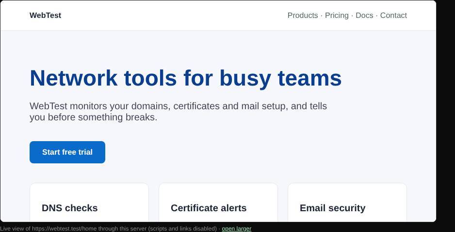

# Website previews

Shows a live, cleaned copy of a site inside the results, loaded through BNGlookup, so you can see a suspicious site without opening it.

| | |
| --- | --- |
| **Where** | [Web check](web-check.md), [Magic scan](magic-scan.md), [Reputation](reputation.md) and [Lookalike domains](lookalike-domains.md) results |
| **Default access** | Logged-in users |

## What it does

The site appears in a frame in the results: the final page in Web check, the
homepage in Magic scan, the site in Reputation, and thumbnails of registered
lookalikes. Click *open larger* to see it in its own tab.

## How it works

1. The server fetches the page, following redirects only to public addresses.
2. Everything that could run code or leave the preview is removed: scripts, event
   handlers, frames, embedded objects, forms and automatic redirects. Links are
   kept as text but do not navigate.
3. The addresses of images, stylesheets and fonts are rewritten to a small asset
   proxy on the server. It only accepts addresses the server signed itself, and
   only for two hours.
4. The cleaned page is shown in a sandboxed frame, with a security policy that
   gives it no origin and no scripts.

| Protection | Effect |
| --- | --- |
| Server-side fetch | Your browser never contacts the site, so the site does not see your IP address. |
| Active content removed | No scripts, forms or redirects can run. |
| Signed asset proxy | The proxy cannot be used to fetch arbitrary files. |
| Sandbox | Even if something slipped through, it could not reach BNGlookup or your session. |

## Good to know

- Sites that build their content with JavaScript may look empty or unstyled.
- Each user can open 200 previews per hour. An administrator can turn previews
  off with `PREVIEWS=false`.

---

[← Back to the wiki](README.md)
