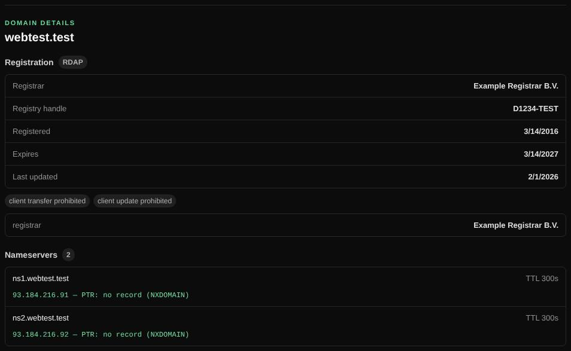

# Whois

Shows who registered a domain or IP address, when it expires, and which name servers it uses.

| | |
| --- | --- |
| **Where** | **Whois** tab |
| **Default access** | Logged-in users |

## What it does

Looks up the public registration of a domain (registrar, dates, status, name
servers, contacts) or an IP address (network range, owner, ASN), and compares the
name servers in the registry with those in DNS.

## How it works

1. **RDAP** (`rdap.org`) is asked first; it returns structured registration data.
2. For registries without RDAP (many country-code TLDs such as `.nl`), classic
   **WHOIS** on TCP port 43 is used: the TLD's server is found through
   `whois.iana.org`, one referral to the registrar is followed, and the raw
   response is shown.
3. Subdomains fall back to their parent domain.
4. The domain's NS records are resolved and their addresses and PTR records are listed.

## What it shows

| Field | Meaning |
| --- | --- |
| Registrar | The company the domain is registered with |
| Registered / Expires / Last updated | Key dates; an expired domain can be taken over |
| Status | Locks such as *client transfer prohibited* |
| Name servers | From the registry and from DNS, with addresses |
| Contacts | Often redacted by the registry for privacy |

## Good to know

- Some registries (for example `.ga`) publish neither RDAP nor WHOIS; the result
  then links the registry's website. An administrator can add a server for such a
  TLD with `WHOIS_SERVERS`.
- Port 43 must be allowed outbound for the WHOIS fallback.

---

[← Back to the wiki](README.md)
